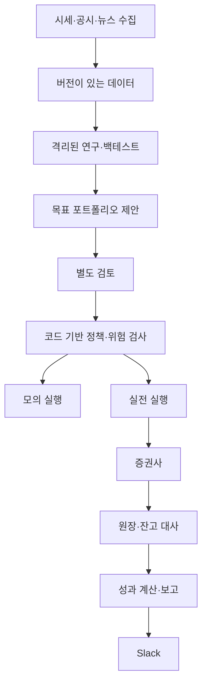

# 투자 시스템 아키텍처 논의 초안

상태: 조사에 따른 제안. ENV 완료 후 ARC 단계에서 검토·확정한다. 이 문서를 승인된 구현 명세로 간주하지 않는다.

2026-10-23 후속 사용자 입력은 [A-DEC-001](decisions/A-DEC-001-initial-product-input.md)을 따른다. 초기 상품에 한국·미국 개별 주식과 일반 ETF를 포함하고 장중 반복 분석·후보 생성을 요구한다. 환전은 사용자가 수행하고 시스템은 현금을 조회한다. 아래 구성 초안의 실제 반영·계약 확정은 ENV 후 ARC에서 하며 세부 주기·세션·주문 권한은 미정이다.

## 구성 후보

- 주요 업무 언어: Python. 사용자 웹 화면이 필요하면 TypeScript 추가 검토.
- 거래·업무 상태: PostgreSQL. 대량 연구 데이터: Parquet와 객체 저장소.
- 백테스트: LEAN을 별도 연구 worker의 우선 후보로 검토. 실전 실행기는 자체 BrokerPort·원장을 사용한다. C# 엔진과 Python 전략의 운영 비용 확인 필요. 초기 Nautilus 등 복수 실행 엔진 도입은 보류한다.
- 증권사: [선택 결정안](research/broker-selection.md)에 따라 첫 어댑터는 KIS를 조건부 권고하고 키움 REST를 대체 후보로 유지한다. 자동 환전이 초기 필수이면 키움 우선순위를 재평가한다. 계좌·기능·데이터 조건과 운영 관문 충족 후 확정한다.
- AI 연구 패턴: TradingAgents, 데이터 계약: OpenBB, 실험 관리: Qlib.
- 주문·대사 설계: NautilusTrader·vn.py, 운영·격리: Freqtrade·Hummingbot, 보고: daily_stock_analysis.

여러 프레임워크를 전부 설치해 연결하는 방안은 확정하지 않았다. 코드 채택과 설계 참고를 구분한다. 20개별 적용 계약·제약·완료 기준은 [OSS 적용 결정안](research/oss-application-plan.md)을 따른다.

## 처리 흐름

모의 성공이 실전 실행을 자동 승인하지 않는다. 실전 계좌·전략·금액·기간·한도는 별도 운용정책에 따른다.

## 데이터 계약

| 영역 | 필수 정보 |
|---|---|
| 계좌·종목 | 증권사·환경·내부 ID·거래소·통화·주문 단위 |
| 금융 이벤트 | 체결·현금·수수료·세금·배당·분할·환전·결제·정정 |
| 주문 | 내부/증권사 ID, 상태·수량·가격·시간·실행 환경 |
| 보유 스냅샷 | 보유·원가·가용금·평가, 가격·환율·대사 기준 |
| 목표안 | 버전·계좌·목표 비중·제약·유효기간·전체/부분 변경 |
| 연구·AI | 출처·데이터·전략·모델·지침 버전, 사용량·검토 |
| 보고 | 원장 버전·기준 시점·잠정/확정·전송·정정 이력 |

금액·수량에는 정확한 소수형을 사용한다. UTC 시각, 시장 시간대, 거래일을 구분한다. 원통화와 기준통화·환율 시점을 함께 기록한다. 발표 시각과 수집 시각을 분리하고 과거 연구에는 당시 알 수 있었던 자료만 사용한다.

수정은 정정 이벤트로 추적하고 원장과 조회 스냅샷을 분리한다. 주문 의도·원장·메시지 발행의 저장 경계와 실패 복구는 ARC에서 명확히 한다. PostgreSQL 또는 해시 연결만으로 완전한 불변성과 중복 없는 실행이 보장된다고 가정하지 않는다.

## 포트폴리오와 리밸런싱

투자 가능 종목군 → 기준 전략 → 후보 전략 비교 → 집중도·현금·통화·회전율 제약 → 목표안 → 실제 보유·미체결·가용금과 차이 계산 순으로 설계한다. 동일 비중을 기준으로 모멘텀·변동성 배분·최소분산 등을 같은 데이터·비용 조건에서 비교하는 안을 검토한다.

월간 정기 검토와 매일 비중 이탈 점검은 초기 제안이며 주기·임계값은 미정이다. 변경안은 비용·환전·주문 단위를 반영한다. 매도를 먼저 제출하는 것과 체결되어 현금이 사용 가능해진 것은 다르다.

완전 목표와 부분 변경을 구분한다. 기존 미체결 중 새 목표가 생기는 경우, 부분체결 후 가격 변화, 종목 누락, 현금 부족, 제안 만료를 별도 처리한다.

## 주문과 실패 처리

- 계좌별 단일 주문 실행자를 통제하고 오래된 실행자가 재개될 때 중복 실행을 막는다.
- 주문 의도와 식별자를 저장하고 접수·부분체결·취소·거절·상태불명을 구분한다.
- 타임아웃 시 접수되지 않았다고 추정하지 않는다. 조회·대사 후 재시도한다.
- 실시간 통보와 조회 결과의 중복·역순·누락을 처리한다.
- 기동·재연결 후 계좌 대사가 끝나기 전 새 위험 증가 주문을 보류한다.
- 신규 주문 중단, 미체결 취소, 자산 청산, 재가동을 별도 명령으로 둔다.
- 승인 후에도 제출 직전에 가격·잔고·한도·데이터 신선도를 다시 검사한다.

## 격리와 배포

개발·수집·연구·모의·실전·보고의 계정·권한·파일·네트워크·자원을 분리한다. 실전은 연구와 별도 실행 자원을 우선 검토한다. 모의·실전은 DB·큐·키·계좌·배포 대상을 구분한다. 보고는 조회용 데이터만 읽는다.

인프라 제품, 큐, 스케줄러, 호스팅, 복구 목표는 미정이다. 애플리케이션의 금융 통제를 개발 도구 Hook에 의존시키지 않는다.

## 보고 일정 제안

| 시점 | 내용 |
|---|---|
| 매일 08:00 KST | 미국장 결과·전체 자산·현금·일정 |
| 한국장 종료 후 대사 완료 | 국장 손익·체결·미체결·비중 |
| 토요일 오전 | 주간 성과·비용·전략 기여·연구 |
| 월간 검토일 | 자산배분·리밸런싱·전략 유지/중단 |
| 중요 예외 발생 | 주문 거절·대사 차이·데이터 지연·위험 제한 |

실제 스케줄은 생성하지 않았다. 시장 달력·서머타임·조기폐장을 반영한다. 대사 미완료는 잠정으로 표시하고 보고 정정·전송 실패를 추적한다. 정기 보고와 예외 경보를 구별해 불필요한 알림을 줄인다.

## 확정이 필요한 결정

운용정책, 데이터 계약·원가/세무 계산 범위, 브로커 지원 매트릭스, 백테스트 엔진, 승인 체계, 서비스·DB 경계, 배포·비밀정보 관리, 복구 목표, 모델 평가, 라이선스 채택 범위, 보고 수신자와 공유 범위.
