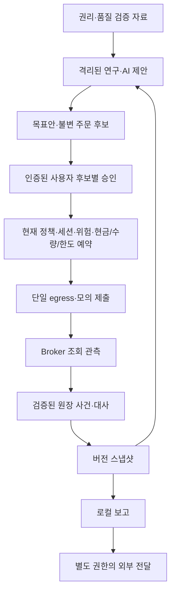

# QuantHarbor 아키텍처 v1

상태: Q12 통합 설계 범위 독립 검토 통과. Q07~11 설계 범위는 독립 검토를 통과했다. 이 문서는 구현할 구조이며 제품 코드·운영 자원·실제 금융 검증 완료를 뜻하지 않는다.

## 확정 범위와 설계 선택

한국·미국 현금계좌·정규장 개별 주식과 일반 ETF, 신용/공매도/레버리지/인버스 제외. 사용자 수동 환전·시스템 현금 조회, 활성 로컬 수동 세션에서 기본15분 분석·후보 생성, 모의 우선·각 주문 후보 사용자 승인이다. 수집/주문/승인 만료는15분과 별개다. 전략은 비교 후 사용자 선택, 실제 자금/위험값은 단계별 [PG 관문](policy-gates.md)에 둔다.

Python·PostgreSQL·Parquet, KIS 첫 BrokerPort 설계 대상·키움 대안, LEAN 별도 연구 엔진 후보를 [B-DEC-001](decisions/B-DEC-001-initial-adoption.md)로 선택했다. 실제 공급자 기능/자료권리·의존성/엔진 버전·제품 모델 활성화는 [SG 관문](research/selection-2026-10-23.md)을 통과해야 한다. OSS20개는 [적용표](research/selection-2026-10-23.md)의 참고/보류 범위로 사용하며 전체 설치나 소스 복사는 승인하지 않았다.

## 계약 정본과 흐름

| 계약 | 소유 사실·규칙 | 후속 작업 |
|---|---|---|
| [data-v1](contracts/data-v1.md) | 기본형·종목·관측/조회 완전성·원장·revision·시점·snapshot·inbox/outbox | C/E/F/I-R |
| [execution-v1](contracts/execution-v1.md) | AI·가설·목표·후보·승인·withdrawal·주문/취소·예약·단일egress·중단 | G/H/I-W/J05 |
| [operations-v1](contracts/operations-v1.md) | 환경/키/권한·로컬 인증/liveness·보고/전달·보존/복원세대 | D/J/M |
| [serialization-v1](contracts/serialization-v1.md) | 정확한 decimal·시각·canonical JSON/hash·DB 제약 | 공통 C 및 모든 producer/consumer |

실전은 별도 자원·정책·계좌·승인 관문을 거쳐 같은 계약을 재검증한 후에만 열린다. 모의 성공이 실전 허가가 아니다. 초기에 자동 청산·자동환전·자동 장애인수·상시 예약 실행은 없다.

## 책임·실패 경계

원장·승인·의도·예약·관련 감사/outbox는 소유 서비스의 transaction으로 변경한다. 외부 API/보고는 transaction 밖이며 접수와 전달 상태불명을 보존한다. lease·해시·DB 사용만으로 외부 exactly-once나 호스트 관리자에 대한 불변성을 보장하지 않는다.

조회 빈결과와 partial, 수량과 평가, 결제현금과 예상 매도대금, 체결과 취소 요청, 승인 소비와 외부 접수를 분리한다. unknown 의도는 최종성/미전송 근거 없이 재제출·예약해제하지 않는다. 환율 방향/원장정정/경제시점과 지식컷오프를 고정하고 과거 연구에 미래 정보를 섞지 않는다.

연구에는 실행 키·금융 쓰기·승인 권한을 주지 않는다. 사용자가 시작한 로컬 세션의 인증/liveness를 admission·dispatch·egress에서 확인한다. 중단 후에도 이미 접수된 원격 주문은 체결될 수 있으며 가능 범위의 조회·대사를 유지한다. 복원 시 기존 승인/세션 권한은 무효화하고 주문 사실과 예약은 보존한다.

## 구현 순서와 미완료

[구현 인계 v1](implementation-backlog.md)의 소유 파일·입력 계약·검증 기준을 따라 Q13 기반→Q14 격리→Q15 검사→Q16~22 데이터/조회/원장/보고→Q23~28 연구/AI/승인/실행/복구→Q29 통합→Q30 지속 모의→Q31~35 별도 실전/운영→Q36 사용자 결정에 따른 확장을 진행한다.

현재 실제 정책값·broker/data 권리·라이브러리/엔진 호환·AI 평가·권한 강제·계좌 대사·복원·운영 성능은 미완료다. 정확한 현재 포인터와 작업별 증거는 [status](status.md), [실행 큐](../config/ai/execution-queue.json)를 따른다. 이전 조사 제안은 계약 정본과 충돌할 때 구현 기준으로 사용하지 않는다. 변경은 관련 producer/consumer·활성 승인/주문·migration/replay 영향을 함께 검토한다.
