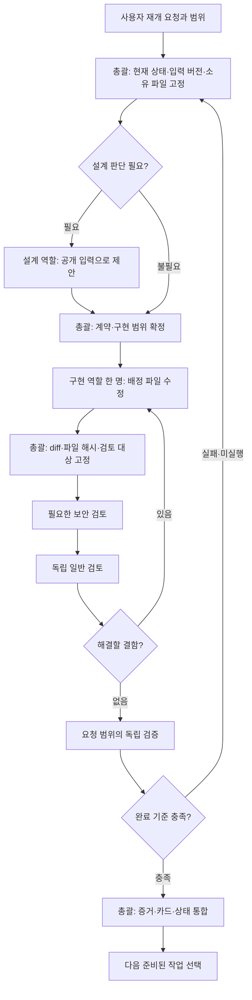

# QuantHarbor 저장소와 cmux 팀 운영 분석

확인일: 2026-10-29. 작업: [ENV-cmux-team-analysis-2026-10-29](../tasks/ENV-cmux-team-analysis-2026-10-29.md). 입력: 로컬 main `80403ab3b8ef322e7d38e8554b42f263bb37cbae`.

## 판단

현재 저장소는 요구사항만 있는 초기 저장소를 넘어 합성 데이터 기반 금융 모듈과 검증 기반이 구현된 상태다. 개발 AI 팀의 역할·계약·인계 절차도 이미 있다. cmux로 작업창을 나누면 담당과 진행을 쉽게 관찰할 수 있지만, 실제 진행 속도는 Q27의 실행·예약·복구 계약과 검토/검증 완료 여부에 좌우된다.

현재 화면 구성은 사용자 후속 요청에 따라 **하나의 cmux 창·동일 workspace 안에 역할별 패널 8개, 한 번에 전문 worker 1명, 작성자 1명**이다. 최초 4분할에서 조사·설계·일반/보안 검토를 각각 분리하고 상태 안내 패널을 추가했다. 화면 세분화이며 여러 AI를 동시에 일시키는 정책 변경은 채택하지 않았다.

사용자의 이번 요청은 저장소 분석과 cmux 팀 구성에 대한 판단으로 처리했다. 자동매매 개발 중단 지시를 해제하거나 Q27 수정·제품/DB 검증을 재개하는 요청으로 확대하지 않았다. 실제 생성하는 작업창은 역할 안내와 대기 셸이며 AI worker의 설정 로드·모델 실행·독립 검토 완료를 뜻하지 않는다.

## 1. 실제 디렉터리와 구현 범위

아래 수치는 착수 시 `git ls-files`에 포함된 파일만 센 값이다. 비추적·ignored·운영 데이터는 열지 않았다. 줄 수에는 주석·빈 줄·문서와 합성 fixture가 포함된다.

| 영역 | 파일 / 줄 | 실제 역할 | 팀 작업에서의 의미 |
|---|---:|---|---|
| `src/` | 73 / 19,141 | Python 금융 도메인·응용·저장소·런타임 | 제품 변경을 배정할 실제 구현 영역 |
| `tests/` | 79 / 17,044 | 제품·품질·팀/환경 검증 코드와 fixture | 파일 존재와 현재 버전의 통과 여부를 구분 |
| `scripts/` | 12 / 5,681 | 합성 실행/원장/격리/품질 검사·감사·환경 조회 | 검증 담당에게 명령·입력·실행 범위를 지정 |
| `docs/` | 379 / 58,374 | 요구·계약·결정·작업 카드·증거·연구 | 새 담당자의 근거와 연속성, 총괄 통합 대상 |
| `config/` | 11 / 1,470 | 팀 정책·전체 큐·런타임 lock·연결 예제 | 설정값과 실제 적용 상태를 따로 확인 |
| `containers/` | 4 / 67 | 합성/시장 저장 Docker 정의·Compose·요구 패키지 | 파일 존재로 현재 컨테이너 기동을 추정하지 않음 |
| `migrations/` | 3 / 1,930 | 기반·원장·실행 SQL | 작성자를 한 명으로 고정해야 하는 공통 영역 |
| `.codex/`, `.agents/` | 9, 3 | 프로젝트 설정·역할·Hook, 프로젝트 Skill | 역할 안내와 선택형 권한 경로. 작업창별 자동 적용은 아님 |

총 추적 파일은 578개다. Python 요구 버전은 `>=3.13,<3.14`, 패키지 버전은 0.1.0이며 `pyproject.toml`의 기본 의존성 목록은 비어 있다. 별도 lock·컨테이너 정의가 있으므로 이를 외부 의존성 없는 완성 제품으로 해석하면 안 된다. 패키지 배포 backend는 후속 과제이며 기존 실행 기준은 `PYTHONPATH=src`다.

### 제품 코드의 구조

| 경로 | 책임 | 대표 내용 |
|---|---|---|
| `domain/` | 업무 규칙·불변 조건·정확한 값 | 종목/달력·시장자료·원장·평가·연구·목표·AI·승인·실행·예산 |
| `ports/` | 기능/저장소의 경계 계약 | broker 조회·원장·시장자료·연구·보고·승인·실행 |
| `application/` | 유스케이스 연결 | 수집·조회·원장·평가·보고·후보·승인·실행 |
| `adapters/` | 합성 구현과 실제 저장소 연결 | KIS 조회 어댑터, PostgreSQL 원장/실행, Parquet, 합성 broker/AI |
| `runtime/` | 설정·권한·격리·CLI | settings·boundary·isolation·report CLI |
| `research/`, `market_data/` | 세부 계산 | 전략/비용/성과, 시간대 |

코드 그래프는 해당 저장소를 ready로 보고했고 조회 시 main SHA도 일치했다. `search_graph → get_code_snippet → trace_path`로 대표 실행 경계를 확인했다. 그래프 노드 수는 변수·문서·함수를 포함하므로 제품 크기나 완성도 지표로 사용하지 않는다.

대표 진입점 [__main__.py](../../src/quantharbor/__main__.py)의 `main()`은 version/status/config 검증/report를 제공한다. 현재 진입점에는 전체 자동매매 제품을 지속 실행하는 명령이 없다. 이는 각 모듈의 구현과 하나의 제품으로 실행 조립하는 P28-03이 별도 작업인 이유다. CLI를 이번에 실행한 결과가 아니라 소스 판독 결과다.

[application/execution.py](../../src/quantharbor/application/execution.py)의 `ExecutionApplication`은 `PostgresExecutionRepository` 타입을 요구하고 제출·취소·대사·재결속 등을 위임한다. 파일 역할은 나뉘어도 이 실행 경계의 변경 영향은 저장소·승인·SQL·broker까지 이어진다.

특히 `adapters/postgres_execution.py`는 1,698줄, `adapters/synthetic_approval.py`는 837줄이다. `dispatch()`는 잠금 안에서 `_arm → _handoff_ready → 시간 검사 → 합성 broker.handoff → 영수증 저장`을 연결한다. 이 구간을 승인·실행·저장 담당자가 동시에 수정하면 각자의 변경이 통과한 버전과 최종 결합 버전이 달라질 위험이 크다. 현재 Q27에는 한 작성자가 적합하다. 크기만을 근거로 지금 대규모 리팩터링을 시작할 이유는 없다.

## 2. 현재 진행 상태와 문서 간 차이

| 대상 | 확인한 상태 | 해석 |
|---|---|---|
| 로컬 Git | main `80403ab`, 부모 2개인 PR #1 병합 커밋, 기본 worktree 1개, 착수 시 clean | 보존된 중간 구현이 로컬 main에 통합됨 |
| 원격 GitHub | 이번 작업에서 조회하지 않음 | 현재 원격 main/PR 상태까지 새로 확인했다고 쓰지 않음 |
| Q01~18 | 전체 큐의 completed 18개 | 과거 승인된 각 범위의 완료 기록. 이번 재검증 결과가 아님 |
| Q19 | 전체 큐 blocked, current 포인터 Q19 | 실제 연결·정책·권리·비공개 입력의 통합 관문 |
| Q20~26 | 전체 pending, 별도 local_status completed 및 로컬 큐 completed 7개 | 합성 로컬 범위 완료. 실제 연결 완료와 구분하는 의도된 구조 |
| Q27 | 로컬 큐 in_progress, 작업 카드/최신 지시는 사용자 요청 보류 | 포인터는 마지막 작업 위치이며 현재 실행 권한이 아님 |
| Q28~29 | pending | Q27 판정 뒤 착수하는 제품/통합 단계 |
| 제품 하위 큐 | P28 8개·P29 2개·RETURN 2개 모두 pending | 기존 36개 완료 수에 더하면 중복 집계 |
| 실제 투자 운영 | 이번에 연결/조회/제출/취소/자금 사용 없음 | cmux 구성과 별도 관문 |

`execution-queue.json`의 Q19와 `offline-execution-queue.json`의 Q27은 [EXEC-DEC-001](../decisions/EXEC-DEC-001-offline-sequence.md)이 구분한 전체 관문과 로컬 개발 위치다. 두 값을 하나로 맞추는 수정은 하지 않았다.

반면 README의 “ENV 구축 중·투자 코드 미구현”, development-environment의 일부 초기 표현, status/Git 카드의 “main 머지 미실행”, 로컬 큐의 보류 미반영은 현재 자료와 차이가 있다. 특히 로컬 main 병합은 실제 Git 이력으로 확인할 수 있다. 팀이 각기 다른 문서 한 개만 읽으면 서로 다른 과제를 시작할 수 있다.

총괄은 **최신 사용자 중단/재개 지시 → status의 최신 관측 → 현재 작업 카드 → 전체/로컬 큐의 범위 → 계약 정본 → 당시 증거**를 함께 확인해야 한다. Git 상태는 실제 branch/head/diff를 별도로 확인한다. 오래된 “다음 작업” 문단을 실행 지시로 승격하지 않는다. 이번에는 status에 현재 관측을 추가하고 과거 카드·큐·완료 증거는 보존했다.

### Q27에서 재개 시 가장 먼저 확인할 부분

[EXECUTION-local 카드](../tasks/EXECUTION-local.md)의 마지막 보안 지적은 source 교체 시 pending 명령의 완료 예약 손실 P2다. 현재 `PostgresExecutionRepository.replace_source()`는 pending/approved 승인을 invalidated로 바꾼 뒤 `s['holds'].pop(identity, None)`를 수행한다. 승인 저장소에는 미완료 command/receipt를 기준으로 필요한 양을 산정하는 `_pending_budget()`도 있다.

따라서 **보존된 코드에 예약 제거 경로가 존재하며 최종 수정 완료를 확인할 수 없다**는 정적 결론을 내릴 수 있다. 현재 DB에서 결함을 새로 재현했거나 포화 후 명령 실패를 확인한 것은 아니다. 기존 카드의 실제 재현은 hold 0 대 필요 4행/262,144bytes였으며 그 당시 증거로 유지한다. 이번 분석에서 코드를 수정하지 않았다.

## 3. cmux 팀 작업창 — 후속 요청으로 8분할

```text
동일 cmux 창 / QH · 팀 운영 분석 workspace / 4열 × 2행
┌────────────┬────────────┬────────────┬────────────┐
│ 01 총괄    │ 02 조사    │ 03 설계    │ 04 구현    │
├────────────┼────────────┼────────────┼────────────┤
│05 일반 검토│06 보안 검토│ 07 검증    │08 작업 보드│
└────────────┴────────────┴────────────┴────────────┘
```

| 작업창 | 대응 역할·저장된 모델 설정 | 실제 작업 방식 |
|---|---|---|
| 01 LEAD | root / gpt-6.1-sol·high | 사용자와 소통, 작업 선택·공통 계약·상태·결과 통합 |
| 02 RESEARCH | qh_researcher / gpt-6-luna·high | 공개 근거·코드 구조·조건·불확실성 반환 |
| 03 ARCHITECT | qh_architect / gpt-6-astra·high | 계약·상태 전이·실패 경로 제안 |
| 04 BUILD | qh_implementer / gpt-6.1-sol·high | 배정 파일의 구현·결함 수정 |
| 05 REVIEW | qh_reviewer / gpt-6.1-sol·high | 고정 버전의 정확성·회귀를 독립 검토 |
| 06 SECURITY | qh_security_reviewer / gpt-6-astra·high | 권한·승인·격리·예약 경계 독립 검토 |
| 07 VERIFY | qh_validator / gpt-6-luna·high | 요청 범위의 검사와 실제 결과·미실행 반환 |
| 08 BOARD | AI 역할 없음 | Q27 보류 등 현재 상태의 정적 안내. 자동 감시/갱신 서비스 아님 |

모델 이름은 [team.toml](../../config/ai/team.toml)의 저장된 배치다. 이번 작업에서 새 모델의 계정 가용성·성능·가격·실제 적용을 확인하지 않았다. 기동 시 기존 제한 실행 경로와 설치 버전의 지원 여부를 확인해야 한다. 저장된 설정만으로 현재 대화의 모델을 단정하지 않는다.

8개 패널은 기존 역할 6개와 root, 상태 안내 1개다. 패널 수를 활성 AI 수로 집계하지 않는다. 같은 checkout의 파일은 공유되며 worktree도 보안 격리를 대신하지 않는다. 각 역할은 실제 기동 시 별도 모델 문맥·권한 프로필을 사용한다.

기존 **QH · 팀 운영 분석** workspace의 4개 패널에 조사·설계·보안·상태 안내 패널을 추가했다. 새 macOS 창이나 workspace는 만들지 않았으며 기존 QuantHarbor/Lead workspace도 보존했다. 각 패널은 역할 설명을 표시한 셸로 대기한다. AI 세션·메시지 라우터·파일 잠금·DB 실행자·예약 작업은 기동하지 않았다. tree·read-screen과 cmux 자체 화면 캡처로 4열×2행 배치와 역할 안내를 확인했다. 범용 Computer Use는 onboarding 미완료로 사용할 수 없어 cmux CLI로 구성·관측했다.

| 실제 작업창 | 이번 cmux 실행의 참조 |
|---|---|
| workspace | `workspace:1000000003` |
| LEAD | `surface:1000000010` |
| RESEARCH | `surface:1000000014` |
| ARCHITECT | `surface:1000000015` |
| BUILD | `surface:1000000012` |
| REVIEW | `surface:1000000011` |
| SECURITY | `surface:1000000016` |
| VERIFY | `surface:1000000013` |
| BOARD | `surface:1000000017` |

참조는 현재 앱 실행의 관측값이다. 역할 안내 기동 파일은 임시 영역에만 두었으며 재부팅/임시 파일 정리 후 자동 재구성을 보장하지 않는다. 영구 dispatcher나 복구 자동화를 설치하지 않았다.

## 4. 하나의 팀으로 실제 작업이 진행되는 순서

아래는 **개발 재개 요청 후** 적용할 시나리오다. 현재 분석 완료만으로 실행되지 않는다.



1. **착수:** LEAD가 사용자 요청·보류 여부·실제 HEAD/작업 트리를 확인한다. Q27처럼 중간 코드가 이미 있으면 재구현보다 저장분과 미검증 범위를 먼저 구분한다. 필요한 작업용 branch/worktree는 그 시점의 범위와 기존 Git 전략에 따라 준비한다.
2. **입력 고정:** 작업 카드에 ID·기준 SHA·미커밋 파일의 해시 목록·계약 버전·허용 도구·소유 파일·제외 파일·완료 기준을 넣는다. 변경 중인 checkout을 읽으면서 고정 버전 검토라고 표시하지 않는다.
3. **조사/설계:** 필요하면 RESEARCH 또는 ARCHITECT 패널의 제한된 읽기 역할을 한 명 실행한다. 공개 근거는 root가 준비한다. 제안은 root에게 반환하며 직접 공통 계약을 고치지 않는다.
4. **구현:** BUILD만 활성 worker가 된다. root도 동시에 제품/공통 파일을 쓰지 않는다. 구현자는 다른 사람의 변경을 되돌리지 않고 범위 밖 문제를 발견하면 근거와 함께 반환한다.
5. **검토 대상 고정:** 구현 종료 후 root가 허용 파일 diff와 보호 파일 불변을 확인한다. 검토 대상은 실제 SHA 또는 동일한 비커밋 파일 manifest로 식별한다. 원격 Git 변경 권한은 별도로 따른다.
6. **독립 검토:** Q27에는 보안 검토와 일반 검토를 순차 수행한다. 작성에 사용한 모델 대화를 reviewer로 이름만 바꾸어 계속 사용하지 않는다. 결과에는 발생 조건·영향·파일/심볼·심각도·확인/추정 구분을 포함한다.
7. **수정 루프:** 결함은 동일 소유 구현자에게 반환한다. 변경으로 영향을 받는 기존 판정만 다시 확인하되, 최종 전체 판정은 실제 최종 입력에 대해 실행해야 한다. old SHA의 PASS를 새 소스에 붙이지 않는다.
8. **검증:** VERIFY가 사용자가 요청한 검사만 수행한다. DB 시나리오는 읽기 코드 검토와 달리 DB mutation을 수반하므로 대상·사용자·합성 입력·자원·정리 범위를 지정한다. 실행 결과를 제품 코드 수정과 섞지 않는다.
9. **통합:** root가 변경·검토·검증의 입력 버전이 맞는지 대조하고 카드/status/보드를 갱신한다. 작업자 exit 0·완료 메시지·창이 조용함을 완료 기준으로 쓰지 않는다.

총괄은 worker가 일할 동안 승인 범위를 확인하고 반환을 관찰할 수 있다. 다만 동시에 다른 전문 역할을 실행하거나 같은 파일을 수정하면 현재 worker1/writer1 계약을 벗어난다. 현재 정책 파일은 이 상한을 모든 프로세스에서 기술적으로 강제하는 분산 잠금이 아니므로 root가 실제 기동과 종료를 관리해야 한다.

### 배정과 반환의 최소 형식

```text
배정: task_id / 목적 / 선행·입력 SHA+파일 manifest / 역할·프로필 /
      소유 파일 / 수정 금지 범위 / 허용 도구·실행 명령 /
      검증 요청 범위 / 산출물 / 완료 기준 / 중단 조건

반환: task_id / 실제 입력 버전 / 변경 파일·근거 /
      PASS·FAIL·NOT RUN / 실행 명령·환경·결과·소요 /
      검토 지적 / 남은 결정 / 다음 담당
```

현재 cmux 작업창은 이 전달 절차를 자동 구현하지 않는다. root가 작업 카드와 산출물을 명시적으로 전달하고 확인한다. cmux 통신 기능이나 `send`가 있다고 작업 요청을 받은 AI가 실행·완료했음을 보장하지 않는다. 자동 dispatcher·감시 daemon이 필요하면 별도 작업으로 범위와 복구를 설계해야 하며 이번에는 만들지 않았다.

## 5. Q27을 예로 든 구체적인 팀 이동

| 순서 | 활성 담당 | 구체적 확인/산출물 | 다음으로 넘기는 조건 |
|---|---|---|---|
| 0 | root | 재개 요청 확인, 보존된 main과 마지막 P2·불완전 인계 대조 | 소유/입력/검증 범위 고정 |
| 1 | 필요 시 architect | pending 명령의 완료 예약이 source 교체 후 보존돼야 하는 불변 조건 정리 | 기존 계약과 대안·영향 확정 |
| 2 | implementer | source 무효화와 `_pending_budget()` 결속의 최소 수정 | 수정 diff·자기 확인·미실행 반환 |
| 3 | security reviewer | 승인 무효화·발급 명령·nonce·세대·예약이 권한을 확장하지 않는지 검토 | 지적 해결 또는 잔여 명시 |
| 4 | reviewer | 정상 source 갱신과 pending 없는 경우·복구·재처리 회귀 검토 | 대상 버전 고정·결함 판정 |
| 5 | validator | 요청된 집중 회귀, 필요한 실제 합성 PostgreSQL 예약/rollback/응답유실 확인 | 명령·입력·실제 결과·정리 증거 |
| 6 | validator | 최종 동일 버전의 Q27 전체 기준 판정 | 최신 전체 결과와 실패·미실행 없음 여부를 명시 |
| 7 | root | 독립 검토/검증을 계약의 완료 조건에 대조 | 충족 시에만 Q27 local 완료 및 Q28 착수 |

실행할 시나리오와 파일 수는 재개 시 현재 runner와 계약에서 확정한다. 과거 “DB84·제품·품질·고정40 예정”을 이번에 전부 통과한 것으로 적지 않는다. 서로 다른 runner·소스 버전의 부분 성공 수를 합쳐 최신 전체 성공 수로 만들지 않는다.

현재 병목은 화면 분할 수보다 최종 버전과 증거의 일치, 예약 수명주기의 반례 해소, 긴 DB 검사 동안의 변경 동결이다. 세션을 늘려도 이 순서는 유지된다. 이 단계에서 대시보드 구현을 동시에 진행하면 선행 계약이 바뀔 때 재작업이 커질 수 있다.

## 6. Q27 이후 팀이 이동하는 경로

1. Q28/P28-01: ARCHITECT의 설계 역할이 화면/사용 흐름/제품 완료표를 제안한다. root 통합 후 독립 검토한다.
2. P28-02: 조회·인증·실행 연결 계약과 영속성/권한 경계를 정한다.
3. P28-03~05: BUILD가 실행 조립 → 사용자 제어/정책/계좌 도입 → 합성 전달/감시/복원을 순차 구현하고 각 범위를 검토/검증한다.
4. P28-06~08: 로컬 조회 대시보드 → 설치/업데이트 → 용량/사용 안내를 구현한다. 화면만 완성하고 제품 실행 조립을 생략하지 않는다.
5. Q29/P29-01/02·RETURN-01: 사용자 전체 흐름·장애·보안·부하·복원과 실제 연결 복귀표를 판정한다.
6. RETURN-02: 사용자 입력과 PG/SG/AP 범위가 충족된 실제 조회·인증·데이터·모의 연결 잔여를 확인한다. Q30 지속 모의의 선행조건이다.
7. Q30 이후: 지속 모의·별도 실전 분리·진입 결정·소액 실전·정책 범위 운영으로 이동한다. 소스 구현이 운영 관찰과 승격 결정을 대체하지 않는다.

근거: [product-delivery-plan](../product-delivery-plan.md), [제품 하위 큐](../tasks/product-delivery-queue.json). 이번 분석에서는 어느 항목도 착수/완료로 바꾸지 않았다.

## 7. 여러 worker를 동시에 운영하려면 필요한 변경

현재 요청의 가정 분석으로는 동시성 정책을 변경하지 않는다. 향후 실제 병렬 실행을 명시 요청하면 root가 먼저 `team.toml`·개발 정책·상위/로컬/제품 큐·팀 문서·AGENTS의 관련 조항을 일관되게 조정해야 한다. 한 파일의 `max_active_workers`만 바꾸어서는 나머지 계약이 남는다.

| 후보 | 병행에 필요한 조건 | 현재 판단 |
|---|---|---|
| 고정 버전의 일반 검토 + 보안 검토 | 두 독립 문맥, 동일 불변 입력, 읽기 전용 경로, 결과를 root가 통합 | 병렬 정책 변경 후 첫 후보 |
| 공개 자료 조사 + 고정 입력 검토 | 입력 범위 비충돌, 외부 도구는 root 소유, 새 조사로 현재 계약 자동 변경 금지 | 읽기 작업부터 제한적으로 가능 |
| UI 조회 화면 + 사용 안내 | P28-01/02 등 선행 충족, 화면/설치 계약 고정, 파일 소유 분리 | 하위 큐 의존관계 조정 전에는 착수 불가 |
| 실행 repository + 승인 + SQL 동시 수정 | transaction·예약·권한·migration의 공통 소유권 해소 필요 | 현재 Q27에서는 부적합 |
| 여러 DB 검사 동시 실행 | 작업별 DB/사용자/포트/자원/증거·정리 소유권과 실행권한 분리 | 같은 합성 DB를 공유하면 부적합 |

쓰기 작업을 병렬화한다면 작업 단위 worktree/branch와 명시 소유 파일을 사용한다. 검토는 불변 입력이면 별도 worktree가 꼭 필요한 것은 아니다. 자격증명·운영 데이터를 worktree에 복사하지 않는다. 같은 사용자 계정의 창·폴더 분리는 비밀정보 접근 차단이 아니다.

예상 이익은 독립 읽기 검토의 대기시간 감소와 담당별 가시성이다. 계약 확정·단일 작성·통합·필수 순차 검증 시간은 남고, 여러 역할의 중복 탐색·버전 충돌·조정 비용은 늘 수 있다. 현재 측정 자료 없이 배속·완료 날짜·비용 절감을 수치로 약속할 수 없다.

## 8. 실제 실행 권한과 재개 안전성

[ENV-DEC-004](../decisions/ENV-DEC-004-role-execution.md)는 역할 실행을 별도 부모의 명시적인 제한 프로필로 수행하도록 정한다. 읽기 역할에는 `qh_review`, 구현/승인된 합성 결과 작성에는 `qh_development`를 적용하고 모델·추론과 apps/plugins/MCP/web/추가 agent 비활성을 명시한다. 새 창이 루트 디렉터리를 열었다고 이 제한이 적용되지는 않는다.

이 구성의 현재 확인 범위는 설정 파일과 과거 증거 판독이다. 새 세션에서의 프로필 로드·Hook 상태·실제 도구 노출·접근 거부는 이번에 확인하지 않았다. 제한 기동 오류 시 권한을 상속하는 direct child로 자동 우회하지 않는다. 코드 탐색/외부 공개 근거는 root가 담당하고 읽기 역할에는 필요한 공개 발췌를 전달한다.

세션이 끊기면 root는 마지막 완료 반환·작업 트리·실행 중 프로세스·미완료 검사·대상 버전을 다시 확인해야 한다. 반환이 없으면 완료로 처리하지 않고, DB/외부 동작은 이전 실행 상태를 확인하기 전에 재전송하지 않는다. cmux 화면/scrollback은 보조 관측이며 작업 카드와 상태 기록을 대신하지 않는다. 창을 열어 둔 것으로 무인 실행·예약 감시·세션 복구가 자동 구현되지는 않는다.

## 9. 이번에 완료한 범위와 한계

- 실제 확인: 저장소 추적 파일/규모, 로컬 Git/worktree, 코드 그래프와 대표 심볼, 팀·권한·큐·Q27 카드·제품 하위 작업의 관계, 설치된 cmux CLI 도움말과 기존 작업창.
- 실제 변경: 본 분석·작업 카드·status의 최신 관측, 별도 cmux 역할 작업창 구성. 작업 카드에 실제 ID/재조회 결과를 연결했다.
- 미실행: Q27 수정, 제품/품질/DB 검사, 금융/API 연결, 독립 검토, 모델 worker 기동과 새 세션 권한/모델 가용성 검증, Git commit/push/merge, Slack 전송, 설치·유료 runner·예약 작업.
- 다음: 이번 분석으로 팀 구조를 검토할 수 있다. 개발 재개 지시가 오면 Q27의 실제 보존분과 마지막 P2부터 입력을 고정해 순차 진행한다. 현재 개발 보류는 유지한다.

## 근거 파일

- [작업 규칙](../../AGENTS.md), [상태](../status.md), [보안](../security.md), [제품 철학](../vision.md), [전체 계획](../plan.md)
- [AI 팀](../ai-team.md), [개발 환경](../development-environment.md), [팀 설정](../../config/ai/team.toml), [개발 정책](../../config/ai/development-policy.toml)
- [전체 큐](../../config/ai/execution-queue.json), [로컬 큐](../tasks/offline-execution-queue.json), [Q27 카드](../tasks/EXECUTION-local.md), [작업 보드](../team-dashboard.md)
- [아키텍처](../architecture.md), [Git 전략](../git-workflow.md), [기존 병합 카드](../tasks/GIT-main-merge-2026-10-29.md), [제품 후속 계획](../product-delivery-plan.md)
