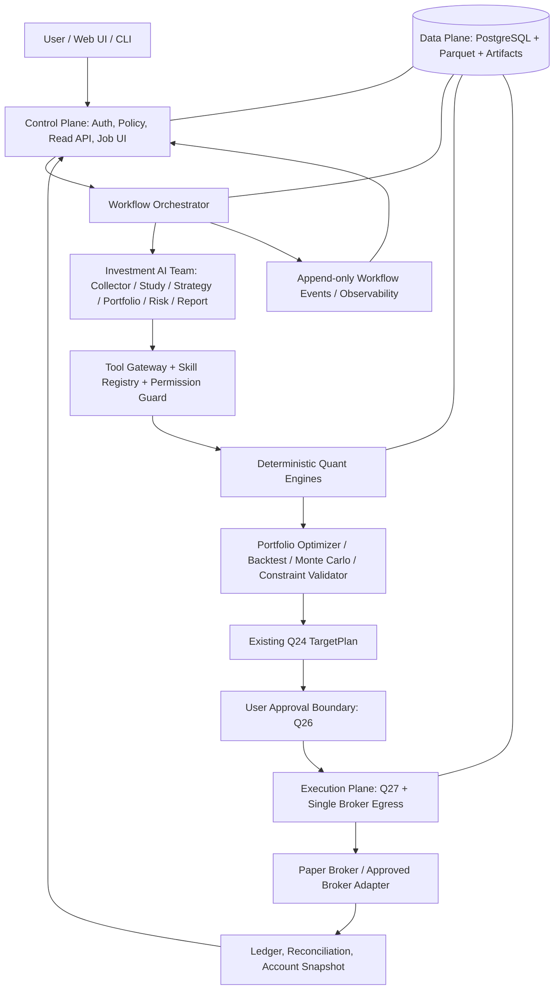
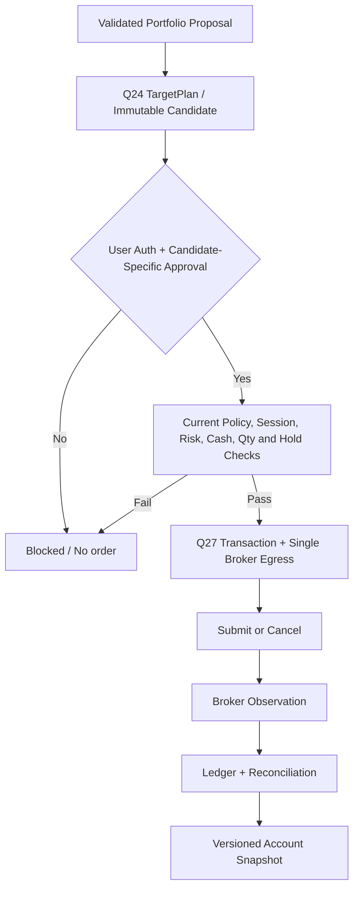
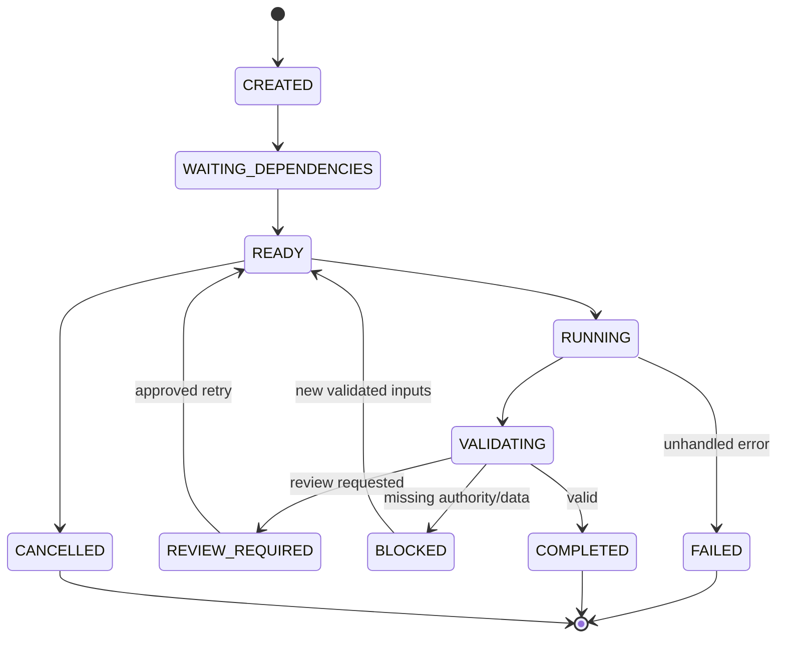
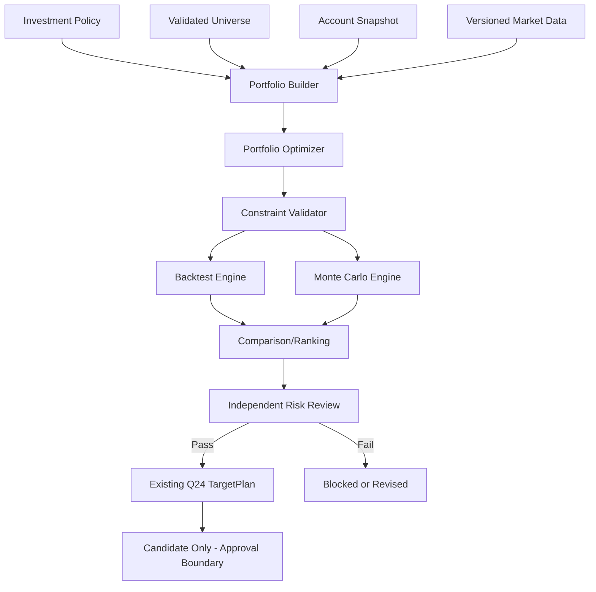
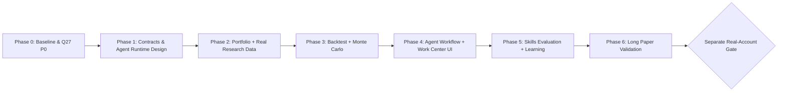

# QuantHarbor 통합 진단 및 Architecture / Multi-Agent / Skills 상세 설계서 v2

- **대상 저장소:** https://github.com/bocopile/QuantHarbor
- **조사·편집 기준일:** 2026-11-14 (Asia/Seoul)
- **문서 목적:** 현재 코드/문서의 구현 범위와 부족한 부분을 구분하고, 포트폴리오·AI 에이전트·스킬셋·투자 연구 엔진·사용자 화면·검증 체계의 목표 구조 및 AI 개발 지시를 단일 문서로 정의한다.
- **문서 유형:** AS-IS 진단 + TO-BE HLD/LLD 초안 + 갭 매트릭스 + 구현 백로그 + 수용 기준 + 개발 에이전트 지시문
- **중요:** 본 문서는 구현 완료 보고서가 아니다. 코드를 로컬에서 전체 실행하거나 실제 증권사/금융계좌와 연동해 검증한 보고서도 아니다.

---

## 목차

1. 핵심 결론 및 판정 규칙
2. 저장소 현행 구조·검증 근거
3. 전체 갭 분석 및 우선순위
4. 목표 아키텍처(HLD) 및 기술 선택
5. 투자 연구·주문 실행 상세 데이터 흐름(LLD)
6. AI 조직 및 Agent Runtime 상세 설계
7. Skillset 전략·카탈로그·실행 계약
8. 포트폴리오 구성·최적화·리밸런싱 설계
9. 대량 백테스트·몬테카를로·강화학습 설계
10. 데이터 거버넌스·감사·보안·복원
11. 사용자 화면과 AI 작업 가시화 설계
12. 소스 코드/문서 구조 개선안
13. 개발 우선순위·로드맵·작업 백로그
14. 검증·수용 기준 및 완료 정의
15. AI 개발 에이전트에게 전달할 실행 지시문
16. 근거 링크 및 확인 한계

---

## 1. 핵심 결론 및 판정 규칙

### 1.1 핵심 결론

QuantHarbor는 한국/미국 주식의 데이터 수집, 투자 연구, 포트폴리오 관리, 모의·실전 매매, 검토·보고를 하나로 묶는 **AI 협업 투자 플랫폼**을 지향한다. 제품 원칙은 **근거 있는 판단 / 통제 가능한 실행 / 축적되는 학습**이다. 단순 매매 봇이 아니라, 학습과 투자 판단을 근거·승인·감사로 연결하는 플랫폼으로 접근해야 한다. [R1]

현행 저장소는 빈 프로젝트가 아니다. 도메인·계약·합성 연구·목표안·승인 및 실행 DB 구현·AI 역할 구분·개발 AI 팀 설정·테스트/검증 기록 등 재사용 자산을 보유한다. 다만 제품으로서 필수인 **동적 포트폴리오 구성, 실제 데이터 연결, 전략 검증, 사용자 작업 화면, 범용 에이전트 오케스트레이션, 운영 검증**은 설계 또는 부분 구현에 머무는 영역이 있다. [R2][R3][R4]

**최우선 원칙:** 금융 코어를 재작성하기보다 기존 계약을 보존하고, 연구와 제안 기능을 상위 계층으로 확장한다. LLM이 주문 실행, 금액·수량 정본 계산, 승인, 위험 한도 우회를 직접 수행하도록 설계하지 않는다.

### 1.2 상태 판정 표준

이 문서에서 다음 표기를 사용한다.

| 기호 | 상태 | 해석 |
|---|---|---|
| **CONFIRMED** | 코드/문서 확인 | 공개 저장소의 구체적 경로에서 사실 확인. 최신 배포 동작까지 검증했다는 의미는 아님 |
| **PARTIAL** | 부분 구현 | 특정 입력 또는 합성 환경에서 동작, 실제 운영 전체 검증 미완료 |
| **DESIGNED** | 설계/계획 | 계약·문서·백로그 존재, 완료 코드/실행 확인 불가 |
| **PROPOSED** | 신규 제안 | 이번 문서에서 새로 권고하는 기능·계층·파일·계약 |
| **UNVERIFIED** | 확인 필요 | 전수 실행/실계좌/실데이터 확인 불가 또는 최신 상태 재검증 필요 |
| **BLOCKED** | 게이트 미충족 | 정책·권한·데이터·검증 요구가 충족되기 전 활성화 금지 |

> **유의:** README의 '현재 단계'는 초기 기록이며, 2026-10-29 PR #1에서 개발 중간 산출물이 `main`에 병합됐다. 실제 기준선은 Git HEAD SHA와 `docs/status.md`·코드·테스트를 함께 대조해야 한다. [R1][R5]

### 1.3 우선순위

- **P0 (안전/진실성):** Q27 미완료 검증·예약 결함 의심, 최신 코드 기준선, 데이터/금융 정책 게이트, 읽기/쓰기 경계, 원장·복구 일치.
- **P1 (MVP 완성):** 포트폴리오 빌더, 실제 시점 적합 데이터 파이프라인, 백테스트, 10,000회 위험 시뮬레이션, AI 작업 화면, 핵심 Agent/Skill 계약.
- **P2 (연구 고도화):** 최적화 기법 비교, 전략 매개변수 탐색, Walk-forward, 전략 검증 자동화, 성과 귀속·학습/평가 루프.
- **P3 (운영 확장):** 강화학습 연구, 반복 개선의 통제된 승격, 장기 모의 운용, 외부 브로커·실계좌 통합은 각 별도 게이트 이후 검토.

---

## 2. 저장소 현행 구조·검증 근거

### 2.1 확인된 핵심 자산

| 구분 | 현재 확인된 사실 | 판정 | 근거 |
|---|---|---|---|
| 제품 방향 | 한국·미국 주식, 자료 수집·연구·포트폴리오·모의/실전·보고 | CONFIRMED | [R1] |
| 아키텍처 v1 | Python/PostgreSQL/Parquet, 한국·미국 현금계좌, 정규장, 일반 ETF, 신용/공매도/레버리지 제외 등 설계 범위 | DESIGNED | [R2] |
| 금융 계약 | `data-v1`, `execution-v1`, `operations-v1`, `serialization-v1` 설계 | CONFIRMED(문서) | [R2] |
| 개발 AI 팀 | orchestrator + 연구·설계·구현·검토·보안·검증 6역할, 명시적 순차 위임 설정 | PARTIAL | [R3][R6] |
| 투자 AI 역할 | `collector`, `study`, `strategy`, `portfolio`, `risk`, `report` 역할/데이터 모델 | PARTIAL | [R7] |
| 개발용 Skills | `.agents/skills` 및 AI 환경 명세에 기존 3개 공통 절차가 정의 | PARTIAL | [R3][R8] |
| 연구 기준 전략 | 합성 연구용 2종목, 각 45% 목표 수량 산출 | CONFIRMED | [R9] |
| 포트폴리오 목표안 | Q24의 목표 비중·수량과 제약 검사 경로 | PARTIAL | [R10] |
| AI 연구 | Q25의 결과·예산·검토 계약, 합성 로컬 실행 중심 | PARTIAL | [R7][R11] |
| 승인 및 실행 | Q26/Q27 승인/예약/원장·PostgreSQL 경로 관련 구현과 검증 기록 | PARTIAL/BLOCKED | [R4][R12] |
| 사용자 UI | 후속 제품 전달·대시보드 계획에 포함, 완성 검증 미확인 | DESIGNED | [R4] |
| 패키징 | Python >=3.13,<3.14, 패키지 빌드/배포 후속으로 명시 | CONFIRMED | [R13] |

### 2.2 오해하기 쉬운 사항

1. **2종목 45%는 전체 시스템 제한이 아니다.** `research/strategies.py`의 합성 연구 기준 전략에서만 확인한 제한이다. 목표 비중/수량을 처리하는 Q24 TargetPlan은 별도 모듈이다. [R9][R10]
2. **'10,000회'는 하나의 뜻이 아니다.** 강화학습 episode/time step, 몬테카를로 시나리오 수, 백테스트 조합 수는 다른 지표다.
3. **개발 AI 팀 ≠ 투자 운영 AI 팀.** 현재 개발 팀의 작업 권한을 투자 운영 에이전트에 그대로 승계하면 안 된다. [R3][R6]
4. **PR merge ≠ 제품 완료.** PR #1의 설명은 Q27 pending 명령 예약과 독립/최신 전체 검증이 남았음을 밝힌다. [R5]
5. **문서상의 완료와 실행 검증은 구분.** 문서/테스트 로그가 있더라도 본 보고서 작성 과정에서 재실행하지 않은 경우 `UNVERIFIED` 상태로 둔다.

### 2.3 반드시 우선 확인할 현행 이슈

**QH-SAFE-01 — `replace_source()` 예약 수명주기 검토**

- 관련 파일: `src/quantharbor/adapters/postgres_execution.py`의 `replace_source()`.
- 확인 내용: 승인 `pending`/`approved` 무효화 시 `s['holds'].pop(identity, None)` 호출이 존재한다. [R12]
- 위험 가설: 발급 후 미완료 명령의 종료 의무/복구를 위한 예약까지 해제되는 경계가 있는지 검토 필요.
- 현재 판정: **정적 코드·PR 리뷰에 근거한 P0 조사/재현 대상.** 이 문서가 모든 시나리오에서 결함을 재현했다는 뜻은 아님.
- 필수 검증: 정책 변경/승인 무효화/복수 미완료 명령/용량 포화/커밋 응답 유실/프로세스 재기동/복구 시 예약과 원장이 원자적으로 닫히는지 실제 PostgreSQL에서 검증.
- 수용: 발급 명령의 성공·거절·미확정 결과를 기록하기 위한 예약을 보존하고, 최종 상태에서는 정확히 한 번 정리하며, 이전 검증 기준을 훼손하지 않을 것.

**QH-AUD-01 — `main`과 상태 문서 동기화**

- 2026-10-29 PR #1 병합 사실을 기준으로 HEAD SHA, 테스트, 실제 Q27 상태, `docs/status.md`, 완료·미완료 목록 정합성을 갱신한다. [R5]
- 범위: 파일 존재, 기능 실행, 가상 데이터 검증, 실계좌/실데이터 연결, 독립 검토, 최신 전체 회귀.
- 과거에 통과한 개별 시험을 합산해 새로운 최신 전체 시험을 통과했다고 표시하지 않는다.

---

## 3. 전체 갭 분석 및 우선순위

| 영역 | AS-IS | 주요 TO-BE | 우선순위 | 작업 ID |
|---|---|---|---|---|
| 금융 실행·예약 | Q27 부분 구현, 최종 독립/통합 검증 미완료 | 명령/예약/원장/복구 불변식 보장 | P0 | QH-SAFE-01 |
| 코드 기준선 | README/상태/브랜치 기록 시점 차이 | 커밋 SHA 기반 구현·문서·시험 지도 | P0 | QH-AUD-01 |
| 투자 정책 | 사용자 결정·승인 경계 | 정책 입력 화면·버전·유효성·변경 이력 | P0 | QH-POL-01 |
| 사용자 인증 | 로컬 인증/권한 설계·부분 구현 | 세션 유효성·역할별 읽기/쓰기 제한 | P0 | QH-SEC-01 |
| 시장 데이터 | 계약 및 로컬 기반 | 실공급자 어댑터·권리·품질·시점 불변 | P0/P1 | QH-DATA-01 |
| 투자 유니버스 | 후보 관리 구체화 필요 | 종목/ETF 탐색·필터·중복노출 분석 | P1 | QH-PORT-01 |
| 포트폴리오 구성 | Q24 목표안, 합성 기준 전략 | 동적 N종목 자산배분/제약 | P1 | QH-PORT-02 |
| 최적화 | 전용 최적화 엔진 확인 안 됨 | 동일비중·위험기반·최소분산·HRP | P1/P2 | QH-PORT-03 |
| 리밸런싱 | 기준 전략 중심 | 비용/허용오차/현금/단위 반영 | P1 | QH-PORT-04 |
| 백테스트 | 합성 비교 | 실제 과거 데이터/오류 회피/OOS | P1 | QH-RES-01 |
| 대량 전략 검증 | 별도 실험 관리 필요 | 10,000 조합 검색·다중 검정 방어 | P2 | QH-RES-02 |
| 몬테카를로 | 별도 위험 엔진 필요 | 10,000 시나리오·VaR/CVaR | P1 | QH-RES-03 |
| 강화학습 | 운영 투자 학습 엔진 미확인 | 격리형 RL 연구·외부 평가 | P3 | QH-RES-04 |
| 실제 LLM | Q25 합성 검증 중심 | 실제 모델 어댑터·도구/비용 경계 | P1/P2 | QH-AI-01 |
| Orchestration | 개발 팀 순차 위임; 투자용 DAG 필요 | 실행상태·체크포인트·재시도 | P1 | QH-AI-02 |
| Skillset | 공통 개발 스킬·투자 절차 후보 | 역할별 계약·입력/출력/평가 | P1 | QH-AI-03 |
| 에이전트 독립 검토 | 설계·계약 기반 | 원작성/검토 분리·근거/품질 검사 | P1 | QH-AI-04 |
| 대시보드 | 제품 완성 계획 | 포트폴리오·에이전트·시뮬레이션 | P1 | QH-UI-01 |
| 이벤트 추적 | 감사/원장 기반 재사용 | 워크플로 이벤트·SSE·분산 추적 | P1 | QH-OBS-01 |
| 지속적 평가 | 학습 철학과 후보 | 결과 평가·Skill 버전 승격 | P2 | QH-LEARN-01 |
| 설치/운영 | 개발 지향 구성 | 패키징·업데이트·복구·배포 검증 | P1 | QH-OPS-01 |
| Broker 연동 | KIS 등 설계 후보, 연동 게이트 | 모의 검증→실계좌 조회→주문 단계별 허용 | P0 이후 | QH-INT-01 |

**주의:** 기존 작업 ID(Q23~Q29, P28/P29, GAP-01~09 등)와 중복되는 항목은 신규 이슈로 중복 완료 처리하지 말고 연결해 관리해야 한다. [R4]

---

## 4. 목표 아키텍처(HLD) 및 기술 선택

### 4.1 핵심 원칙

1. **Modular Monolith First:** 우선 현행 Python 도메인 및 포트/어댑터를 유지한다. 역할 격리를 위해 연구 워커, 제어 API, 금융 실행 프로세스를 별도로 운영할 수 있다.
2. **LLM/Deterministic Split:** LLM은 가설, 분석 해석, 비교, 반론, 설명을 담당하고 수량/금액/정책/체결/원장 계산은 결정론적 코드가 담당한다.
3. **Bounded Context:** 개발 AI, 투자 AI 연구, 포트폴리오 계산, 금융 실행, 데이터 관리의 소유 데이터 및 권한을 분리한다.
4. **Evidence-First:** 입력 데이터·출처·시점·가정·도구/모델 버전·실험 결과를 연결한다.
5. **Fail Closed:** 권한·시점·데이터·예산·정책 상태를 확인할 수 없으면 실행 불가.
6. **No Autonomous Live Trading:** 기존 사용자 승인과 금융 게이트를 우회하지 않는다.

### 4.2 논리 아키텍처



> 위는 **TO-BE 개념도**다. 화살표는 논리적 데이터 흐름이며 모든 노드가 현재 구현됐음을 의미하지 않는다. 실제 연결은 인증된 포트와 엄격한 읽기/쓰기 정책을 거친다.

### 4.3 계층별 책임과 기술 후보

| 계층 | 담당 | 권장 구현 | 규칙 |
|---|---|---|---|
| Presentation | 포트폴리오/연구/AI 작업 화면 | React 또는 Vue + TypeScript | 금융 상태 변경은 별도 승인 경계 |
| Control API | 세션/정책/작업 조회 | FastAPI 후보 | 기존 로컬 인증 경계 보존 |
| Orchestration | DAG, 배정, 상태, 재개 | Python + PostgreSQL 영속 상태 | 재시작 후 일관된 작업 상태 |
| AI Runtime | 역할별 프롬프트, 도구, 예산, 스킬 | Python adapter + Tool Gateway | 역할별 허용 도구 외 호출 차단 |
| Research/Quant | 최적화·통계·실험 실행 | Python, NumPy/Pandas 등 후보 | 정량 계산·재현성 검증 |
| Financial Core | 정책·대사·목표안·승인·주문 | 기존 domain/application/ports/adapters | 현행 계약 유지 |
| Persistence | 금융 정본·연구 시계열·아티팩트 | PostgreSQL / Parquet / 버전 저장소 | 출처·해시·시각 관리 |
| Observability | 실행 진행, 오류, 감사 | 구조화 이벤트, OpenTelemetry 후보 | 실데이터 비밀정보 기록 금지 |

**의존성 결론:** 새로운 프레임워크를 즉시 채택하지 않는다. 현재 `pyproject.toml`은 Python 3.13 및 외부 의존성 미정 상태이므로 라이선스·버전·폐쇄/로컬 운영성·설치 재현성 검증 후 ADR로 결정한다. [R13]

### 4.4 Trust Boundary

```text
[Untrusted Web/News/Market Documents]
        | data validation, licensing, provenance
        v
[Collector + Read-Only Research Zone]
        | versioned evidence, schema checks
        v
[Deterministic Research Engines]
        | validated proposal only
        v
[Risk Review + Policy Guard]
        | never financial write
        v
[Q24 Immutable Candidate]
        | explicit user authentication/approval
        v
[Q26/Q27 Financial Execution Zone]
        | single egress, transactional persistence
        v
[Broker + Ledger/Reconciliation]
```

리서치 LLM 프로세스에는 브로커 주문 자격증명, 원장 변경 권한, 정책 임의 변경 권한을 제공하지 않는다. 외부 문서·뉴스는 프롬프트 지시가 아닌 **비신뢰 자료**로 취급한다.

---

## 5. 상세 데이터 흐름(LLD)

### 5.1 투자 연구 실행

1. 사용자가 투자 기간·금액·대상 국가·자산·손실 허용 조건·목표를 입력한다.
2. 정책·권리·계좌 스냅샷이 유효한지 검사한다. 누락 시 `BLOCKED`.
3. `Collector`가 데이터 출처·수정 이력·거래일·환율 등을 확인하고 `DataEvidence`를 생성한다.
4. `Study`가 가설/반론/불확실성을 기록한다.
5. `Strategy`가 데이터 누출 없는 백테스트 명세를 정의한다.
6. 연구 엔진이 거래 비용을 반영한 과거 검증을 수행한다.
7. `Portfolio`가 유효한 자산 후보로 다수의 비중안을 제안한다.
8. 정량 엔진이 최적화·다자산 시뮬레이션을 수행한다.
9. `Risk`가 별도 invocation/모델 컨텍스트에서 독립 검토한다.
10. `Report`가 수치 근거와 한계, 승인이 필요한 결정을 정리한다.
11. 승인된 연구 결과가 Q24의 **후보 생성 입력**으로만 전달된다. 연구 완료는 주문 승인이 아니다.

### 5.2 주문 실행 플로우(기존 경계 보존)



**절대 금지:** LLM 응답을 API 주문 페이로드로 직접 변환해 전송하거나, 사용자가 정하지 않은 손실 한도·투자 금액을 자동 채택하지 않는다.

### 5.3 문맥/상태 종류는 구별

- **Workflow Task Status:** created, waiting, ready, running, validating, review_required, completed, blocked, failed, cancelled (제안).
- **Q25 ResearchResult Status:** 현행 결과 상태 계약을 보존한다. 워크플로 상태와 통합하지 않는다.
- **Financial Execution Status:** 기존 승인/주문/취소/체결/불명/복구 계약의 권위. AI 작업 상태와 독립.

상태를 혼동하면 'AI 연구 성공 → 금융 실행 완료'로 잘못 해석하는 심각한 UI/제어 오류가 발생할 수 있다.

---

## 6. AI 조직 및 Agent Runtime 상세 설계

### 6.1 개발 AI 팀과 투자 AI 팀의 물리적/논리적 분리

**개발 AI (AS-IS):** root orchestrator + `qh_researcher`, `qh_architect`, `qh_implementer`, `qh_reviewer`, `qh_security_reviewer`, `qh_validator` 등. `config/ai/team.toml`은 순차 실행, 최대 1개 활성 워커, 재귀 위임 금지를 명시한다. [R6]

**투자 운영 AI (TO-BE):** Collector/Study/Strategy/Portfolio/Risk/Report 6역할 + 별도 Workflow Orchestrator. 투자 AI는 제품 데이터/연구 조회만 허용하며 개발 파일 쓰기 또는 운영 비밀 접근을 금지한다. [R3][R7]

### 6.2 에이전트 역할 계약

| Agent | 대표 입력 | 책임 | 출력 | 금지 권한 |
|---|---|---|---|---|
| Orchestrator | 사용자 요청, 정책, DAG, budget | 계획, 선행 조건, 배정, 재시도, 중단, 검증 예약 | WorkflowRun | 주문 승인 대행 |
| Collector | 종목, 관측 기간, 공급자, 데이터 정책 | 출처·품질·시점·완전성 검사 | DataEvidence, QualityReport | 브로커 주문, 정본 수정 |
| Study | 공시, 가격, 연구 노트 | 가설·반론·변경 이유 | Hypothesis, ResearchNote | 사실 미확인 수익률 확정 |
| Strategy | 가설, 실험 스펙 | 전략 후보, 백테스트 설계, 평가 | StrategyProposal | 평가셋 무단 참조 |
| Portfolio | 현금/보유 스냅샷, 정책, 전략 | N종목 후보, 목표 비중, 리밸런싱 제안 | PortfolioProposal | 주문 수량 정본/주문 직접 실행 |
| Risk | 후보안, 수익률 분포, 정책 | 집중도·위기·반론 독립 검토 | RiskReview | 임의 위험 한도 승인 |
| Report | 검증 산출물, 상태, 비용 | 근거 기반 보고서 작성 | InvestmentReport | 실현되지 않은 성과 확정 |

### 6.3 Orchestrator의 필수 기능

- `run_id`, `task_id`, `parent_task_id`, `schema_version`, `agent_role`, `skill_id/version` 관리.
- DAG 선행 조건 검사, 입력 아티팩트 해시·정책 버전 고정.
- 호출별 allowed tools, 읽기 영역, 비용/토큰/시간/재시도 상한 강제.
- 워커 실행 전 capacity/lease 확인 및 완료 후 검증·상태 이벤트 기록.
- LLM 결과를 직접 다음 작업에 전달하지 않고 구조적 검증기와 도메인 검사기로 필터링.
- 타임아웃/네트워크 오류 시 멱등 작업만 자동 재시도; 금융 실행 불명 상태는 별도 Q27 로직 우선.
- 작업 취소 시 안전하게 미완료 이벤트와 아티팩트를 마감; 디버그 정보와 개인/계좌 정보 분리.
- 작업 재개 시 체크포인트를 읽더라도 현재 정책/자격/데이터 유효성을 재검사.

### 6.4 Workflow 상태 머신 (신규 제안)



### 6.5 공통 에이전트 실행 계약 예시 (PROPOSED)

```json
{
  "schema_version": 1,
  "run_id": "synthetic-run-001",
  "task_id": "portfolio-build-001",
  "agent_role": "portfolio",
  "skill_id": "portfolio-construction",
  "skill_version": "1.0.0",
  "environment": "synthetic",
  "input_manifest_hash": "example-only",
  "policy_ref": "synthetic-policy-001",
  "allowed_tool_ids": ["snapshot_view", "research_view", "optimizer_view"],
  "budget_ref": "synthetic-budget-001",
  "status": "created"
}
```

이 형식은 신규 제안이며 현행 `ai-local-v1` 등의 프로토콜과 정확히 일치하도록 계약 적합성 검토 후 확정해야 한다.

### 6.6 평가 포인트

- 제한된 읽기 도구 외 호출 요청 100% 차단.
- 도구 호출 실패/권리 차단 시 허위 근거로 채우지 않음.
- 동일 입력·버전에서 구조적 출력의 재현 가능성 및 차이 추적.
- Risk의 검토는 작성 Agent와 독립된 실행 ID를 보유.
- 취소/재실행/재시작 후 중복 아티팩트·중복 금융 명령이 발생하지 않음.

---

## 7. Skillset 전략·카탈로그·실행 계약

### 7.1 구분

- **Agent:** 역할 및 목표를 갖고 도구·스킬을 호출하는 실행 주체.
- **Skill:** 특정 업무 수행 절차, 입력·출력, 검증, 중단 조건의 재사용 가능한 명세.
- **Tool:** 실데이터 조회·계산·영속 기록 등 권한 제어 가능한 실행 인터페이스.
- **Contract:** 버전·스키마·권한·도메인 불변식의 기계적 약속.

Skill 설치만으로 API/DB 권한이 열려서는 안 된다. 런타임의 도구 게이트웨이가 별도 허가를 강제한다.

### 7.2 기존 개발 Skill (재사용)

1. `qh-task-handoff` — 작업 인계, 검증 증거, 완료 범위.
2. `qh-evidence-decision` — 근거와 불확실성을 분리한 의사결정.
3. `qh-contract-change` — 도메인 계약 변경과 하위 영향 조사.

근거: [R3][R8]. 실제 스킬의 경로·파일명은 최신 HEAD에서 확인한다.

### 7.3 추가 개발 Skill (PROPOSED)

| Skill | 목적 | 필수 평가 |
|---|---|---|
| qh-architecture-review | 레이어·데이터 흐름·권한 경계 검토 | 의존 방향/ADR/호환성 |
| qh-financial-contract-audit | Decimal·수량·통화·시점 검증 | 정확값과 도메인 불변식 |
| qh-backtest-audit | 백테스트의 데이터 누출·통계 위험 검증 | OOS·거래 비용·생존자 편향 |
| qh-agent-evaluation | Agent 출력·툴·근거 검증 | 허위 근거·스키마·역할 위반 |
| qh-security-boundary | 보안/프롬프트 인젝션/브로커 경계 검토 | 권한 우회 금지 |
| qh-observability-review | 이벤트·감사·시각화 검증 | 누락 이벤트·PII 마스킹 |
| qh-recovery-validation | 장애·재시작·중복·용량 검증 | 멱등성·원장·복구 일치 |

### 7.4 투자 AI Skill 14종 (PROPOSED)

| ID | 주 사용 Agent | 핵심 목적 | 산출물 |
|---|---|---|---|
| market-data-quality | Collector | 가격/환율/거래일 품질 평가 | DataQualityReport |
| financial-evidence | Collector/Study | 공시·뉴스 근거 및 출처 연결 | EvidenceBundle |
| investment-hypothesis | Study | 투자 가설/반론/무효화 조건 | Hypothesis |
| strategy-research | Strategy | 전략 및 실험 설계 | StrategyExperiment |
| backtest-validation | Strategy/Risk | 과최적화·데이터 누출 검증 | BacktestReview |
| parameter-sweep | Strategy | 대량 파라미터 실험 평가 | StrategyRanking |
| universe-screening | Portfolio | 투자 가능 종목 선별 | UniverseProposal |
| portfolio-construction | Portfolio | 정책 기반 자산 구성안 생성 | PortfolioProposal |
| portfolio-optimization | Portfolio | 정량 최적화 결과 비교 해석 | OptimizationReview |
| monte-carlo-risk | Risk | 10,000회 위험 분석 해석 | SimulationReview |
| independent-risk-review | Risk | 독립 반론 및 위험 검토 | ResearchReview |
| rebalance-analysis | Portfolio | 허용오차/비용 기반 재조정 평가 | RebalanceProposal |
| performance-attribution | Report | 종목/통화/전략 성과 귀속 | AttributionReport |
| learning-review | Study/Report | 과거 가설과 실현 결과 비교 | LearningReview |

### 7.5 Skill의 필수 메타데이터

각 스킬에는 최소 다음 개념을 정의한다.

```yaml
skill_id: portfolio-construction
version: 1.0.0
owner_role: portfolio
input_schema: PortfolioBuildRequest.v1
output_schema: PortfolioProposal.v1
allowed_tools:
  - snapshot_view
  - research_view
  - optimizer_view
required_checks:
  - policy_complete
  - snapshot_complete
  - input_manifest_valid
  - currency_consistent
  - constraints_satisfied
execution:
  environment: synthetic
  financial_write: false
  requires_independent_review: true
failure_policy:
  missing_policy: blocked
  incomplete_snapshot: blocked
  invalid_numeric: invalid
  unsupported_tool: blocked
```

> 예시 계약이다. 현행 Q25 도구 허용표에 존재하지 않는 이름은 실제 실행 권한이 없으며, 도구/런타임/스키마를 함께 개정해야 한다.

### 7.6 `portfolio-construction` Skill 실행 절차

1. 입력 참조, 유효기간, 환경(합성/실제), 계약 버전 검증.
2. 계좌 평가금액·보유·현금·환율 일관성 검증.
3. 사용자 정책과 유니버스의 제약 검증.
4. 결정론적 `PortfolioOptimizerPort`를 통해 비중 산출.
5. 비교 가능한 대안(기준 전략 포함)을 생성.
6. 위험/비용/거래 가능 여부를 분석.
7. 표준 `PortfolioProposal`을 반환하고 독립 Risk Review 요청.
8. 실제 금융 실행 명령은 발행하지 않음.

**중단 조건:** 미확인 계좌, 필수 환율 누락, 정책 미결정, 데이터 권리 미확인, 시점 충돌, 해 없음, 스키마 오류.

### 7.7 Skill 지속 개선과 승격

- 등록: draft / candidate / validated / active / deprecated.
- 입력 평가셋: 금융 정책 경계, 정상/결측/오염/악성 입력, 가격 급변, 통화 불일치 등.
- 평가 지표: 출처 정확도, 사실 오류, 정량 결과 일치, 역할 권한 준수, 비용, 재현성, 검토자가 발견한 누락.
- 승격: 수정 Skill 버전을 이전 고정 버전과 같은 데이터셋 및 별도 홀드아웃으로 평가하고 승인 후 적용.
- 롤백: Skill 버전·프롬프트·모델·도구 버전 동시 기록으로 특정 실행을 이전 버전으로 재현.
- 금지: 에이전트가 자기 Skill을 변경한 즉시 실거래 흐름에 배포하는 자동 승격.

---

## 8. 포트폴리오 구성·최적화·리밸런싱 설계

### 8.1 현재와 목표

현재 `research/strategies.py`는 합성 시뮬레이션에서 두 종목을 각 NAV의 45% 목표로 계획한다. 이는 테스트용 단순 기준 전략이며, Q24 TargetPlan의 목표 비중·수량 기능과 분리된 것이다. [R9][R10]

목표는 **투자 정책 → 유니버스 → 포트폴리오 최적화 → 위험 검증 → 과거/미래 시뮬레이션 → Q24 TargetPlan 연결**이다.



### 8.2 Portfolio Builder 입력 계약 (제안)

| 필드 | 역할 |
|---|---|
| portfolio_id | 포트폴리오 식별자 |
| account_snapshot_ref | 현금/보유·평가 스냅샷(해시/버전) |
| investment_policy_ref | 사용자가 결정한 투자 범위/한도 |
| universe_ref | 투자 가능한 종목/ETF 목록 |
| objective | 동일비중/위험기반/최소분산 등 |
| constraint_set_ref | 종목·업종·국가·통화 제한 |
| market_data_ref | 당시 사용 가능한 데이터 버전 |
| cost_model_ref | 수수료·세금·슬리피지·최소 주문단위 |
| as_of | 평가/결정 기준 시점 |
| knowledge_cutoff | 당시 실제 알 수 있었던 정보 시점 |
| benchmark_refs | SPY/시장지수 등 비교 대상(정책에 따름) |

### 8.3 자산배분 방법

| 방법 | MVP 여부 | 특징/주의 |
|---|---|---|
| 사용자 지정 비중 | MVP | 명확한 통제, 입력 검증 필수 |
| 동일비중 | MVP | 강력한 기준선, 거래 비용 고려 |
| 변동성 역비례 | 2단계 | 변동성 큰 자산 비중 완화 |
| 위험균형/Risk Parity | 2단계 | 공분산 안정성 확인 필요 |
| 최소분산 | 2단계 | 공분산 추정오차/쏠림 위험 |
| HRP | 2단계 | 군집 기반 분산투자 대안 |
| 평균-분산 | 고도화 | 기대수익 추정 민감도 높음 |
| Black-Litterman | 고도화 | 사전 분포·관측 신뢰도 명시 |

라이브러리 후보: `PyPortfolioOpt`, `Riskfolio-Lib`, `skfolio`. 도입 전 Python 3.13·의존성·라이선스·성능을 테스트한 ADR 필요. 도구 도입이 현재 구현을 의미하지 않는다.

### 8.4 필수 제약 및 정책

- 포트폴리오 목표 비중 합계(현금 포함) = 1. 자산별 음수 비중은 현행 현금계좌 정책에서 금지.
- 종목별 최대 비중, 업종/국가/통화 한도, 동일 그룹·ETF 기초자산 중복 노출.
- 최소 잔여 현금, 수수료/세금, 예상 슬리피지, 거래 단위, 가격/호가 유효기간.
- 리밸런싱 임계값과 예상 이득/비용 비교.
- 한국/미국 투자 시 KRW/USD 환율, 거래일·정규장·공휴일, 가격 데이터의 수정 여부.
- 결측/상장폐지/기업행위 자료를 무단 생략하지 않음.
- 사용자 정책에 없는 수익 목표/손실 한도를 AI가 새로 정하지 않음.

### 8.5 출력 계약 예시

```json
{
  "schema_version": 1,
  "environment": "synthetic",
  "proposal_id": "synthetic-portfolio-001",
  "allocation_method": "equal_weight_baseline_example",
  "target_weights": [
    {"instrument_id": "SYNTHETIC-A", "weight": "0.45"},
    {"instrument_id": "SYNTHETIC-B", "weight": "0.45"}
  ],
  "target_cash_weight": "0.10",
  "constraint_status": "passed",
  "risk_review_status": "pending",
  "execution_authorized": false
}
```

**예시 주의:** 45%/45%/10%는 기존 합성 연구 방식에서 따온 설명값이며 실제 추천 투자 비중이 아니다. 이 JSON은 신규 설명용 계약으로, 실제 canonical 직렬화 계약과 일치 여부를 먼저 확인해야 한다.

### 8.6 리밸런싱 판단

- 정기(월/분기) + 이탈 허용오차(예: 정책값) + 거래 비용을 함께 평가.
- 변경 필요성 = 목표 비중과 현재 비중의 차이 + 시장 위험 + 거래 비용 + 세금 + 현금/최소 주문단위.
- 현금 입금/출금, 미체결 주문, 일부 체결, 거래 정지 자산은 실제 계좌 스냅샷으로 판단.
- **AI는 제안만 수행**, 최종 후보 산출은 Q24, 승인·실행은 Q26/Q27이 담당.

### 8.7 포트폴리오 수용 기준

- 2종목 고정 제한 없이 합성 N종목을 처리할 것.
- 자산·현금 비중 정합성, 도메인 수량/통화 정합성.
- 허용 불가 투자 대상과 정책 위반을 **후보 생성 전에** 차단.
- 기준 전략 대비 비용 포함 백테스트 결과 비교.
- 다자산 상관관계, 집중도 및 위험지표를 동일 평가 시점으로 산출.
- 정상/극단/결측/중복/유동성 부족/환율 누락 사례 시험.

---

## 9. 대량 백테스트·몬테카를로·강화학습 설계

### 9.1 '10,000회' 세 유형의 차이

| 유형 | 10,000의 의미 | 학습 여부 | 주요 산출물 |
|---|---|---|---|
| 강화학습 | Episode 또는 environment step 수 | 예(정책 학습) | 학습된 정책/보상/평가 성과 |
| 몬테카를로 | 미래 시장/포트폴리오 경로 수 | 보통 아님 | 손실확률, VaR/CVaR, 분포 |
| 백테스트 탐색 | 전략/파라미터/종목 조합 수 | 전략 선택/튜닝 | OOS 순위와 과최적화 지표 |

세 방법은 상호 보완적이나 구현 엔진과 검증 방법이 다르다.

### 9.2 권장 순서

**과거 백테스트 → 10,000회 몬테카를로 위험 실험 → 강화학습 연구**.

강화학습을 먼저 도입하면 외부 성능 평가/거래 비용/데이터 누출 방어 기반이 미흡한 상태에서 '10,000번 학습했으니 수익이 좋다'라는 잘못된 결론으로 이어질 수 있다.

### 9.3 Backtesting Engine 요구사항

- 시점 정합 데이터를 이용한 이벤트/벡터화 백테스트(필요한 경우 병행).
- 수수료, 슬리피지, 매매 지연, 가격 상·하한, 유동성, 거래 정지, 기업행위, 환율 반영.
- 생존자 편향(survivorship bias), 미래 데이터 누출(look-ahead), 데이터 스누핑 방어.
- Walk-forward/expanding window, 홀드아웃 데이터, 전략 파라미터 선택 절차 고정.
- 다중 전략 실험 시 Deflated Sharpe/다중 검정 고려 또는 유사한 통계적 과최적화 경고.
- 실험 불변 인자: 시장 데이터 해시, 코드/전략 커밋, 비용 모델, 정책, 시드, 평가 시점.

**필수 결과:** CAGR, 연수익률, Sharpe, Sortino, MDD, turnover, 총비용, benchmark excess, 구간별 안정성, 전략 실패 사유.

### 9.4 Monte Carlo Engine 요구사항

- 기본 10,000개 경로(설정 가능)와 시드 고정.
- 자산 간 공분산/상관관계 및 환율 위험을 고려.
- GBM 하나에 의존하지 말고 블록 부트스트랩, 두꺼운 꼬리 분포 등 모형별 결과를 비교.
- 각 결과는 분포 가정, 보유 기간, 리밸런싱, 비용, 환율 가정을 노출.
- 최종 자산 분포, 원금 손실 확률, VaR, CVaR, 예상 MDD, 분위수, 위기 시나리오를 제공.
- 10,000개의 경로는 통계적 예측의 '확정성'을 의미하지 않는다는 경고를 제공.

### 9.5 강화학습(RL) 연구 요구사항

- `reset/step`이 명확한 합성/과거 데이터 환경에서만 학습.
- 상태: 과거 관측(미래 정보 금지), 현재 포지션, 현금, 거래비용, 허용 위험.
- 행동: 매수/매도/유지 또는 목표 비중. 정책에 따라 제한.
- 보상: 단순 수익률 외 거래비용·변동성·최대 손실 패널티 등을 실험적으로 비교.
- 학습/검증/테스트 데이터 기간을 엄격하게 분리.
- episode 수, step 수, 실제 주문 발생 횟수를 별도로 기록.
- PPO, DQN, A2C 등은 연구 후보. 운영 정책으로 즉시 적용하지 않는다.
- 강화학습이 제안한 정책도 기존 Strategy/Portfolio/Risk/Approval 체계를 반드시 통과.

### 9.6 비교·벤치마킹 대상 GitHub

**강화학습 / 반복 가상매매**

- DRL-Finance: https://github.com/kveje/DRL-Finance — 10,000 episode 설정 참조.
- rl-trader: https://github.com/aekram43/rl-trader — 반복 학습 step 예제(주식이 아닌 암호화폐 데이터 사용 사례 포함).
- StockTradingRL: https://github.com/SBrouck/StockTradingRL — PPO 기반 주가 데이터 연구 예제.

**몬테카를로 10,000회**

- Monte-Carlo-Portfolio: https://github.com/JK-BB/Monte-Carlo-Portfolio
- MC-Simulation-Portfolio-Analysis: https://github.com/christopherkim2/MC-Simulation-Portfolio-Analysis
- Monte-Carlo-Portfolio-Simulator: https://github.com/zenith256/Monte-Carlo-Portfolio-Simulator
- portfolio-monte-carlo: https://github.com/Ericsalt88/portfolio-monte-carlo

**대량 백테스트**

- algorithmic-trading-backtest: https://github.com/Het415/algorithmic-trading-backtest
- strategy-survival-funnel: https://github.com/crollila/strategy-survival-funnel
- vectorbt: https://github.com/polakowo/vectorbt

> 본 절의 외부 저장소는 **참조 및 벤치마킹 후보**다. 의존성, 유지관리 상태, 라이선스, 실제 수치, 데이터 권리는 채택 전에 각 저장소 HEAD를 재검증한다. 특히 10,000회 '설정'과 10,000회 '실행 완료/성과 검증'을 동일시하지 않는다.

---

## 10. 데이터 거버넌스·감사·보안·복원

### 10.1 데이터 소유권

- **PostgreSQL:** 정책/권한/계좌 스냅샷/실행 명령/원장·대사/워크플로 상태의 권위 있는 정본.
- **Parquet:** 대량 가격·특성·연구 시계열 및 재현 가능한 입력 스냅샷.
- **Artifact Store:** 연구 보고서, 전략 설정, AI 근거, 실험 그래프, 결과 해시.
- **Event Log:** 워크플로 관측 이벤트. 금융 원장을 대체하지 않는다.

### 10.2 데이터 계보(Provenance) 필수 필드

`source_id`, `license_ref`, `retrieved_at`, `observed_at`, `published_at`(적용 시), `effective_at`, `revision_id`, `content_hash`, `timezone`, `currency`, `quality_flags`, `knowledge_cutoff`.

백테스트에서 데이터가 존재했다는 이유만으로 해당 과거 시점에 사용 가능했다고 해석하면 안 된다.

### 10.3 보안 및 정책

- 연구 AI에는 읽기 전용 도구와 필요 최소 데이터만 허용.
- 원문 공시/뉴스/웹 페이지는 신뢰되지 않는 데이터로 처리; 문서 속 지시문 실행 금지.
- 실계좌 비밀키는 투자 분석 프로세스와 분리·암호화·회전·감사.
- Q24~Q27 금융 경계를 UI 편의 기능으로 우회하지 않음.
- 최종 거래 승인과 위험 한도는 사용자가 명시적으로 결정.
- 실제 계좌 조회·모의 주문·실전 주문을 서로 다른 환경과 키로 분리.

### 10.4 장애 복구 요구

- 영속 checkpoint, 실행 lease, 태스크 idempotency key.
- 프로세스 중단·재시작·중복 네트워크 응답·DB 커밋 응답 유실 분기.
- 미확정 금융 주문은 '미실행'으로 가정하지 않고 Broker observation + 원장 대사로 확인.
- 저장 용량 부족 시에도 이미 수락한 명령의 종료 의무를 기록할 수 있어야 함.
- 복구 후 계좌 스냅샷·원장·승인·미체결 주문 정합성 검증.

---

## 11. 사용자 화면과 AI 작업 가시화 설계

### 11.1 제품 화면 IA

1. **Portfolio Studio:** 자산 탐색, 목표 비중, 비교안, 제약 경고, 리밸런싱 제안.
2. **Research Lab:** 가설·출처·전략·백테스트·실험 버전 비교.
3. **Simulation Lab:** 몬테카를로 분포·신뢰 구간·위험·스트레스 시나리오.
4. **AI Work Center:** 에이전트 DAG·현재 단계·상태·근거·비용·오류.
5. **Investment Control:** 보유·현금·승인 요청·후보/주문/체결/대사 상태.
6. **Operations:** 데이터 연결 상태, 설치, 보안, 복구, 감사, 알림.

### 11.2 AI Work Center 주요 구성

```text
┌──────────────────────────────────────────────────────────────────┐
│ Research Run: synthetic-run-001  | Policy: v12  | Data: 2026-.. │
├──────────────────────────────────────────────────────────────────┤
│ Collector  [COMPLETED] ──┐                                       │
│ Study      [COMPLETED] ──┼── Strategy [COMPLETED]                 │
│                          └── Portfolio [VALIDATING]              │
│                                 ├── Backtest [COMPLETED]         │
│                                 └── Monte Carlo [COMPLETED]      │
│                                           ↓                      │
│                                     Risk [READY] → Report        │
├──────────────────────────────────────────────────────────────────┤
│ 선택 작업 상세: 입력 아티팩트 / 근거 / 도구 호출 / 위험 / 시간     │
│ 오류 / 재시도 / 모델·Skill 버전 / 토큰·비용 / 생성 결과             │
└──────────────────────────────────────────────────────────────────┘
```

> 위 상태는 제품 UI 예시이며 실제 QuantHarbor 실행 기록이 아니다.

### 11.3 제안 이벤트 계약

```json
{
  "schema_version": 1,
  "event_type": "agent.task.completed",
  "environment": "synthetic",
  "run_id": "run-001",
  "task_id": "portfolio-analysis-001",
  "agent_role": "portfolio",
  "skill_id": "portfolio-construction",
  "skill_version": "1.0.0",
  "status": "completed",
  "input_manifest_hash": "example-hash",
  "result_ref": "proposal-001",
  "validation_status": "passed",
  "occurred_at": "2026-11-14T09:00:00Z"
}
```

**필수:** 이벤트는 append-only, run/task별 순서·중복 제거 가능, 비밀/PII 마스킹, 조회 전용 UI에 실시간 SSE 또는 동등한 이벤트 스트림 제공. 이벤트는 원장 사실을 대신하지 않는다.

### 11.4 학습 루프의 UI

1. **기록:** 어떤 가설을 어떤 데이터와 근거로 만들었나?
2. **평가:** 예측 시한이 지난 후 실제 결과와 얼마나 달랐나?
3. **진단:** 데이터 오류/가설 오류/모델 한계/비용·실행 차이 중 무엇이 원인인가?
4. **개선 제안:** Skill/프롬프트/툴/평가셋의 변경 후보.
5. **검증 및 승격:** 고정 평가셋 + 홀드아웃 성능 비교 + 독립 검토 + 승인.

자동 학습은 '기록을 축적하고, 검증된 개선을 관리한다'는 뜻으로 시작한다. 실거래 정책 자동 변경과는 별개다.

---

## 12. 소스 코드/문서 구조 개선안

아래는 기존 도메인/포트/어댑터를 유지한 **추가·확장 목표 구조**다. 신규 파일명이 현행 저장소에 존재한다는 뜻은 아니다.

```text
QuantHarbor/
├── AGENTS.md
├── .agents/skills/
│   ├── qh-task-handoff/             # 기존
│   ├── qh-evidence-decision/        # 기존
│   ├── qh-contract-change/          # 기존
│   ├── qh-architecture-review/      # 제안
│   ├── qh-backtest-audit/           # 제안
│   └── qh-agent-evaluation/         # 제안
├── config/
│   ├── ai/                          # 기존 개발 AI 환경
│   └── investment_ai/               # 제안
│       ├── agents/
│       ├── skills/
│       └── workflows/
├── src/quantharbor/
│   ├── domain/                      # 기존 확장
│   ├── application/                 # 기존 확장
│   ├── ports/                       # 기존 확장
│   ├── adapters/                    # 기존 확장
│   ├── research/                    # 기존 확장
│   │   ├── portfolio_optimizer.py   # 제안
│   │   ├── monte_carlo.py           # 제안
│   │   └── backtest_sweep.py        # 제안
│   ├── investment_workflows/        # 제안
│   │   ├── orchestrator.py
│   │   ├── state_machine.py
│   │   ├── checkpoint.py
│   │   └── event_publisher.py
│   └── presentation/                # 제안
│       └── read_api/
├── frontend/                         # 제안
│   ├── portfolio/
│   ├── research/
│   ├── agents/
│   ├── simulation/
│   └── operations/
├── docs/
│   ├── architecture/                # 제안 HLD/LLD
│   ├── agents/                      # 제안 역할 계약
│   ├── skills/                      # 제안 Skill 카탈로그
│   ├── adr/                         # 제안 기술 결정
│   └── contracts/                   # 기존 계약 유지/버전 확장
└── tests/
    ├── agent_evals/                 # 제안
    ├── portfolio/                   # 제안
    ├── integration/                 # 제안
    └── resilience/                  # 제안
```

구조 변경 전에 실제 `src`, `docs`, `tests` 파일 소유자, 계약 import 관계와 마이그레이션 상태를 자동 추출해 **기존 파일 수정 / 신규 파일 생성 / 중복 금지**를 결정한다.

---

## 13. 개발 우선순위·로드맵·작업 백로그

### 13.1 선후 의존성



### 13.2 단계별 산출물

| 단계 | 주 개발 범위 | 핵심 완료 산출물 |
|---|---|---|
| Phase 0 | Q27/HEAD/상태 문서/실행 안전 | 증거 기반 기준선, P0 위험 회귀 통과 |
| Phase 1 | HLD/LLD/Agent/Skill/Tool 계약 | 컴포넌트·권한·스키마·ADR·수용 기준 |
| Phase 2 | 사용자 정책·유니버스·포트폴리오 | N종목 합성 포트폴리오, Q24 계약 연결 |
| Phase 3 | 과거 데이터 백테스트·몬테카를로 | 버전 고정 실험, 10,000회 통계·위험 결과 |
| Phase 4 | 6-Agent DAG·검증·UI | 관측 가능한 작업 실행 및 결과 검토 |
| Phase 5 | Skill 평가·Learning Review | 고정 평가셋, 승격/롤백, 실패 분석 |
| Phase 6 | 장애/복구·장기 모의 운영 | 누락/중복/변경 없이 반복 실행 증거 |
| 별도 관문 | 실제 계좌 조회·주문·실전 운영 | 사용자 정책·권한·기관·기술 검증 후 허용 |

### 13.3 권장 작업 티켓

| Task ID | 작업 | 의존 조건 | Definition of Done (요약) |
|---|---|---|---|
| QH-AUD-01 | 최신 main/문서/테스트 인벤토리 | 없음 | HEAD SHA+경로+증거+미확인 분리 |
| QH-SAFE-01 | Q27 보유 예약/종료 불변식 확인·수정 | AUD | 실제 PostgreSQL 재현/회귀/독립 검토 |
| QH-POL-01 | 정책 입력·유효성 모델 | AUD | 정책 미확정이면 차단, 버전 불변 |
| QH-SEC-01 | 읽기 API/권한 경계 설계 | AUD | 권한 우회 음성 테스트 |
| QH-DATA-01 | 시장 데이터 품질/계보 | POL/SEC | 시점/결측/정정/권리 검사 |
| QH-PORT-01 | 종목/ETF 유니버스 | DATA | 동적 후보, 필터/중복 노출 |
| QH-PORT-02 | Portfolio Builder MVP | PORT-01/POL | N종목+현금=1, 정책/비용 검사 |
| QH-PORT-03 | Portfolio Optimizer | PORT-02 | 기준전략 vs 위험 기반 최적화 |
| QH-PORT-04 | Q24 및 리밸런싱 연결 | PORT-02, SAFE | 주문 후보만, 실제 승인은 별도 |
| QH-RES-01 | 신뢰 가능한 백테스트 | DATA | OOS/비용/룩어헤드 방어 |
| QH-RES-02 | 매개변수 대량 탐색 | RES-01 | 재현·다중 검정/과적합 경고 |
| QH-RES-03 | 몬테카를로 10,000회 | PORT-02/DATA | seed/분포/위험 재현 |
| QH-AI-01 | 투자 LLM 어댑터 | SEC/Agent 계약 | 역할/도구/예산 제한 통과 |
| QH-AI-02 | Workflow Orchestrator | 계약 확정 | DAG/상태/중단/재개/멱등 테스트 |
| QH-AI-03 | 투자 Skills/Registry | AI-02 | 14개 중 MVP, 입력/출력/거부 시험 |
| QH-AI-04 | 독립 Risk Review | AI-02/PORT | 검토 독립성/반례 기록 |
| QH-OBS-01 | Run Event/추적/비용 | AI-02 | append-only, UI 재생, PII 가림 |
| QH-UI-01 | Portfolio/Research/AI Work Center | API/OBS/PORT/RES | 실행 근거 확인·작업 상태 구별 |
| QH-LEARN-01 | 학습 평가·승격 | AI/RES/OBS | 버전 비교, 홀드아웃, 승인/롤백 |
| QH-OPS-01 | 패키징/업데이트/복구 | SAFE 이후 | 재설치·복원·감사 상태 복구 |

### 13.4 기존 프로젝트 백로그와 동기화

- 원래 Q/P/GAP ID의 완료 판정을 삭제하거나 변경하기 전에 해당 책임자와 증거를 대조한다.
- 신규 티켓은 기존 `product-delivery-plan`, `status`, `execution queue`의 **하위 구현 작업**으로 매핑한다.
- 동일한 완료/미완료 기능을 두 군데에서 따로 '완료'로 표시하지 않는다.

---

## 14. 검증·수용 기준 및 완료 정의

### 14.1 공통 DoD 체크리스트

- [ ] 구현 범위와 AS-IS 근거를 파일/함수/테스트 단위로 추적했다.
- [ ] 기존 계약·정확값·단일 권위 경계를 유지했다.
- [ ] 신규 계약의 schema version 및 호환성·마이그레이션을 명시했다.
- [ ] 도메인 불변식, 실패/차단, 멱등성, 중복 호출 테스트가 있다.
- [ ] 연구 결과에 입력 데이터·정책·전략·시드·버전·근거 해시가 남는다.
- [ ] LLM은 금융 데이터/거래 결과를 임의 생성하지 않는다.
- [ ] 허용되지 않은 Tool/파일/DB/금융 권한 접근이 차단된다.
- [ ] 정상 시나리오뿐 아니라 결측·만료·정정·재시작·용량 포화 시나리오를 통과했다.
- [ ] 리뷰/보안/검증은 구현자와 독립적으로 수행했다.
- [ ] 최신 최종 고정본에서 재실행한 시험인지 명시했다.
- [ ] 사용자 문서·운영 문서·상태 기록이 코드와 일치한다.

### 14.2 Agent 평가

| 검증 | 수용 기준 |
|---|---|
| 역할 권한 | 허용 외 도구 호출 100% 차단 |
| 결과 스키마 | 모든 필수 필드·버전 유효 |
| 출처 | 모든 핵심 사실/수치에 근거 참조 |
| 정량 검증 | 공식 결정론적 엔진 출력과 일치 |
| 독립 검토 | 작성자와 분리된 Review 결과 존재 |
| 예산 | 사전 예약·소비·취소 정산 일치 |
| 장애 | 취소/실패/재시작 후 상태 복원 |
| 금융 안전 | AI 직접 주문/승인 불가 |

### 14.3 Portfolio/Research 평가

| 검증 | 수용 기준 |
|---|---|
| 포트폴리오 | N종목·현금·비중/통화/제약 일치 |
| 기준 전략 | cash, buy-and-hold, equal-weight 등과 비교 |
| 최적화 | 해 없는 경우 명시적으로 차단 |
| 백테스트 | OOS/Walk-forward, 거래 비용 반영 |
| 몬테카를로 | 동일 시드/입력/모델/버전 재현 |
| 장기 모의 | 잔고·거래·기록·재시작 정합성 |
| UI | Agent/Research/Financial 상태를 구분 표시 |

### 14.4 문서 완성 기준

최소 산출물(한 파일에서 출발하여 구현 단계에서 분리 가능):

- `system-architecture-v2.md` — 목표/현행 컨텍스트·컴포넌트·배포.
- `architecture-gap-matrix.md` — AS-IS 코드 vs TO-BE 책임 1:1.
- `agent-runtime-design.md` — 상태·위임·취소·재개·예산.
- `agent-role-contracts.md` — 여섯 역할의 도구·입력/출력·거부.
- `skill-catalog.md` — 트리거·절차·검증·버전.
- `portfolio-engine-design.md` — 배분·최적화·제약·Q24.
- `research-engine-design.md` — 백테스트·몬테카를로·RL.
- `workflow-events-v1.md` — 이벤트·아티팩트·체크포인트.
- `ai-observability-design.md` — 타임라인·UI·오류·비용.
- `learning-evaluation-design.md` — 실험·평가·승격.
- `security-and-trust-boundaries.md` — 도구·DB·브로커 경계.
- `acceptance-test-matrix.md` — 테스트 계층/수용 기준.

---

## 15. AI 개발 에이전트에게 전달할 실행 지시문

아래 블록을 AI 개발 도구에 그대로 전달할 수 있다. **이 문서는 완성된 시스템의 사실 목록이 아니며 검증해야 할 가설과 신규 제안을 포함한다는 점**을 먼저 인식시키는 것이 중요하다.

```text
당신은 QuantHarbor 프로젝트의 Principal Architect이자 Multi-Agent System Auditor이다.

목표:
현재 main 코드/계약/문서/테스트를 분석해 AS-IS/TO-BE 격차를 증거 중심으로 확정하고,
AI 투자 연구 플랫폼의 아키텍처, 포트폴리오 엔진, 투자 에이전트,
스킬셋, 작업 시각화, 위험 통제, 검증 체계를 구현 가능한 설계로 상세화한다.

작업 규칙:
1. 가장 먼저 HEAD SHA와 저장소 구조를 확정한다.
2. 이 통합 설계서의 모든 CONFIRMED/PARTIAL/DESIGNED/PROPOSED 항목을 실제 코드와 교차검증한다.
3. README와 docs/status.md가 최신 코드와 충돌하면 최신 코드와 실행 증거를 우선하고 충돌을 기록한다.
4. 기존 data-v1/execution-v1/operations-v1/serialization-v1/ai-local-v1 계약의 무단 변경을 금지한다.
5. 기존 Q23~Q27, Q28/Q29, GAP 작업과 신규 기능의 중복 여부를 확인한다.
6. 각 요구사항을 Existing Reuse / Modify Existing / New Build / Not Needed / Blocked로 분류한다.
7. 실제 사용자 정책/위험/실계좌/키가 없으면 임의값을 실제 환경 기본값으로 채우지 않는다.
8. LLM의 금융 쓰기, 승인 대행, 주문 실행, 계좌 잔고 정본 수정은 금지한다.
9. 외부 라이브러리 도입 시 버전·라이선스·유지보수·Python 호환성과 성능을 조사한다.
10. 소스를 수정하기 전 반드시 인터페이스·모듈 책임·입출력·실패 조건·테스트를 설계한다.

Phase A — Baseline Audit:
- 파일 트리·도메인/포트/어댑터·설계/구현 매핑을 작성하라.
- 각 주장은 file:line 또는 실제 테스트 증거와 연결하라.
- Q27의 pending command/holds/approval/source replacement 불변식을 우선 분석하라.
- 최신 전체 통합 검증의 미실행/실패/통과 범위를 분리하라.

Phase B — HLD/LLD:
- C4 Context/Container/Component 수준의 시스템 아키텍처를 그려라.
- Control/Research/Execution/Data Plane과 Trust Boundary를 상세 정의하라.
- 시장 데이터 수집→투자 가설→전략→포트폴리오→Risk Review→Q24→사용자 승인→Q27→원장 대사 흐름을 작성하라.
- 각 컴포넌트의 책임·소유 데이터·입력/출력·오류·복구·API/Tool 계약을 정의하라.

Phase C — Agent & Skills:
- 개발 AI Team과 투자 운영 AI Team을 분리하라.
- Collector/Study/Strategy/Portfolio/Risk/Report + Orchestrator의 role contract를 정의하라.
- Skill 카탈로그, 트리거, allowed tools, schema, negative test, 버전/평가 정책을 설계하라.
- 역할별 tool permission과 실제 런타임 강제 여부를 증명하라.
- Workflow 상태 머신, DAG, checkpoint, idempotency, cancel/retry를 설계하라.

Phase D — Quant Engine:
- 동적 N종목 Portfolio Builder, 기준전략, 위험 기반 최적화, 제약 검사, 리밸런싱을 설계하라.
- 과거 데이터 백테스트·OOS/Walk-forward·10,000회 몬테카를로·강화학습 연구를 서로 다른 엔진으로 정의하라.
- 결과에 데이터/정책/전략/모델/시드/코드 버전과 재현 가능한 manifest를 연결하라.
- 기존 Q24와 계약을 지키며 연결하고, 주문 자체는 승인되지 않은 상태로 유지하라.

Phase E — Product/Observability:
- Portfolio Studio / Research Lab / Simulation Lab / AI Work Center / Operations 화면을 설계하라.
- 사용자에게 Agent의 현재 수행 작업, 출처, 진행상태, 실패, 비용, 결과 근거를 시각화하라.
- Workflow 이벤트와 금융 원장 이벤트가 서로 다른 사실임을 명확히 하라.

Phase F — Implementation Planning:
- 각 컴포넌트를 reuse/modify/new로 분해하고 코드 소유/신규 파일을 정하라.
- P0→P1→P2→P3 의존성 백로그, 예상 리스크, ADR, 수용 테스트를 작성하라.
- 작업별 단위·통합·보안·복구·성능 테스트를 모두 명시하라.

필수 결과 형식:
1. Executive Summary
2. Confirmed AS-IS (file/line evidence)
3. Unverified/Blocked Register
4. Architecture Diagram / Trust Boundaries
5. Component Inventory & Contract Matrix
6. Agent Roles / Tool Permission Matrix
7. Skill Catalog + 3개 핵심 Skill 상세 명세
8. Portfolio / Backtest / Monte Carlo LLD
9. Data / Events / Observability / UI design
10. Dependency-Ordered Implementation Backlog
11. Acceptance Tests / Quality Gates
12. Existing Reuse vs New Work Matrix
13. ADR / Open Decisions / Owner Questions

금지:
- 구현하지 않은 기능을 완료라고 보고하지 말 것.
- 합성 검증을 실계좌 검증으로 표현하지 말 것.
- 금융 안전 검사를 프롬프트 수준의 약속으로 대체하지 말 것.
- 과거 전체 테스트 결과를 최신 HEAD에 대한 검증으로 재사용하지 말 것.
- 외부 OSS 라이선스를 확인하지 않고 코드/모델을 무단 복제하지 말 것.

진행 방식:
우선 Phase A의 근거 기반 진단과 Phase B 설계안을 제출하고,
검증된 기준선/계약/수용기준이 마련된 이후 구현 단계로 진입한다.
```

---

## 16. 근거 링크 및 확인 한계

### 16.1 QuantHarbor 공식 저장소·문서

- **[R1] 저장소 및 README:** https://github.com/bocopile/QuantHarbor
- **[R2] 아키텍처 v1:** https://github.com/bocopile/QuantHarbor/blob/main/docs/architecture.md
- **[R3] AI 제반환경:** https://github.com/bocopile/QuantHarbor/blob/main/docs/ai-environment.md
- **[R4] 진행 상태/작업 계획:** https://github.com/bocopile/QuantHarbor/blob/main/docs/status.md
- **[R5] PR #1 (2026-10-29 병합, 미완료 상태 명시):** https://github.com/bocopile/QuantHarbor/pull/1
- **[R6] 개발 AI Team 설정:** https://github.com/bocopile/QuantHarbor/blob/main/config/ai/team.toml
- **[R7] 투자 AI 도메인:** https://github.com/bocopile/QuantHarbor/blob/main/src/quantharbor/domain/investment_ai.py
- **[R8] 개발용 Skills 위치:** https://github.com/bocopile/QuantHarbor/tree/main/.agents/skills
- **[R9] 합성 기준 전략(두 종목 각 45%):** https://github.com/bocopile/QuantHarbor/blob/main/src/quantharbor/research/strategies.py
- **[R10] Q24 관련 구현/설계 검색 출발점:** https://github.com/bocopile/QuantHarbor/tree/main/src/quantharbor
- **[R11] Q25 관련 설계/상태 검색 출발점:** https://github.com/bocopile/QuantHarbor/tree/main/docs
- **[R12] Q27 PostgreSQL execution 구현(`replace_source` 등):** https://github.com/bocopile/QuantHarbor/blob/main/src/quantharbor/adapters/postgres_execution.py
- **[R13] Python/패키징 상태:** https://github.com/bocopile/QuantHarbor/blob/main/pyproject.toml

### 16.2 한계와 재검증 원칙

- GitHub 공개 페이지와 앞선 조사 내용을 기반으로 편집했다. 저장소 전체 클론/로컬 DB 실행/정적 분석기 일괄 실행을 이 작성 과정에서 수행하지 않았다.
- 따라서 구현 상태는 **인벤토리와 설계 진단** 수준이며, 각 코드 변경을 수행하는 AI는 반드시 최신 HEAD를 재검사해야 한다.
- 외부 GitHub 벤치마크 목록은 아키텍처 참고 후보로 제공한 것이며 채택 승인 또는 성능 보증이 아니다.
- 신규 Skill/YAML/JSON/API/UI/디렉터리·도식은 설계 예시일 수 있다. 반드시 `PROPOSED` 여부를 구분하여 구현하도록 한다.
- 금융 계산·포트폴리오 최적화·시뮬레이션 결과는 투자 자문이나 수익 보장이 아니다.

---

**최종 권고:** QuantHarbor는 `Architecture → Contracts → Agent Roles/Skills → Deterministic Quant Tools → Tests → Observability/UI → Controlled Paper Trading` 순서로 개선한다. 이 중 먼저 해결할 것은 **Q27 실행 안전 기준선**, 그리고 신규 가치 창출의 첫 MVP는 **Portfolio Builder + 검증 가능한 Backtesting Lab**이다. AI 작업 과정의 가시화와 Skill의 평가·승격은 제품의 핵심 차별점이므로 후순위 장식이 아니라 설계 초기부터 이벤트 계약으로 포함한다.
