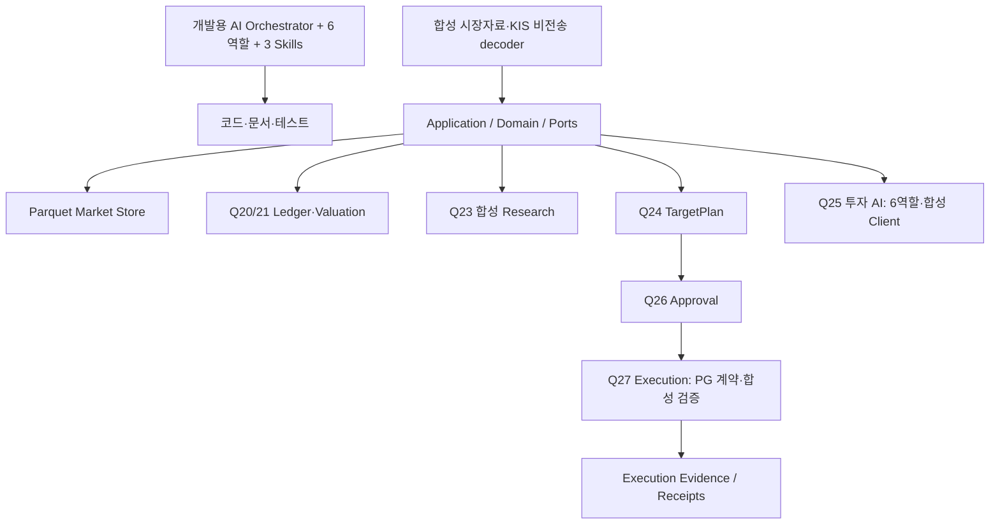
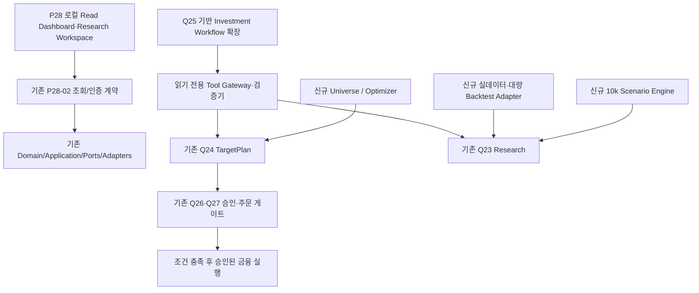
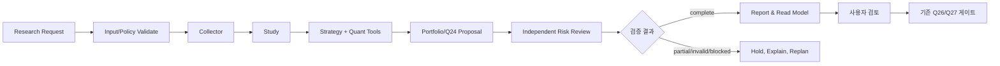

# QuantHarbor `main` 브랜치 재감사 및 개선 설계서 v3

- **대상:** https://github.com/bocopile/QuantHarbor
- **코드 기준선:** `main`의 확인된 merge commit `80403ab` (2026-10-29)
- **재점검일:** 2026-11-15 (Asia/Seoul)
- **작성 목적:** 이전 `QuantHarbor_Integrated_Audit_Architecture_Agent_Skills_v2.md`에서 이미 반영된 항목을 신규 개발로 잘못 분류한 부분을 정정하고, 기존 자산을 재사용하는 구현 계획을 제시한다.
- **방법:** 공개 GitHub의 실제 코드·테스트·설계·인계 문서 대조. 로컬 전체 clone, 실제 PostgreSQL 시험, 증권사 연결 시험, 전체 테스트 실행 **미수행**.
- **주의:** 파일 존재, 검증 코드 존재, 테스트 통과, 제품 완성, 실계좌 연결은 서로 다른 주장이다. 이 보고서는 앞선 v2를 **구현 상태 및 우선순위 판단에 관하여 대체**한다.

---

## 목차

1. 결론과 검증 기준
2. 이전 v2 문서의 정정 사항
3. AS-IS 구현 인벤토리
4. Q27 예약 수명주기: 결함 재판정
5. 현재 아키텍처와 최소 변경 원칙
6. 포트폴리오: Q24 재사용과 신규 최적화의 경계
7. 연구·백테스트·몬테카를로·강화학습
8. 개발 AI와 투자 AI: Agent 및 Skill 재설계
9. P28/P29: 이미 설계/착수된 제품 전달 작업
10. 데이터·증권사·운영·보안·CI
11. 정정한 백로그 및 실행 우선순위
12. 완료 조건/수용 테스트
13. AI 개발 에이전트에게 전달할 정정 지시문
14. 증거 링크 및 조사 한계

---

## 1. 결론과 검증 기준

### 1.1 핵심 결론

**QuantHarbor는 아키텍처나 금융 코어를 처음부터 새로 만드는 프로젝트가 아니다.** 현재 `main`에는 `Domain / Application / Ports / Adapters` 기반 모듈, 데이터 처리·검증, 로컬 금융 원장, 목표 포트폴리오의 수량/비중 변환, 합성 연구, 투자 AI 6역할 계약·검증, 승인·실행 제어, 개발 AI 팀, 개발용 Skill, 회귀 테스트가 존재한다.

앞선 v2가 과장한 신규 개발 영역은 다음과 같다.

1. **Q27 pending-command 예약 결함:** 해결 로직과 대응 테스트가 이미 반영되었다. 새 수정 작업이 아니라 **현 코드의 실제 DB 회귀·독립 검토·최종 판정**이 남은 상태다.
2. **Q24 TargetPlan:** 범용 목표 비중/수량, 현금·노출·비용·유효성·주문후보 검사가 이미 있다. **새로운 부분은 종목 후보 생성, 자산배분 최적화, 사용자 구성을 위한 상위 계층**이다.
3. **Q25 투자 AI:** 6역할, 읽기 허용 범위, 결과·근거·비용·가설·독립 검토를 위한 **합성 실행 기반**이 있다. 실제 LLM 연결, 제품 UI와 연동되는 장기 워크플로, 도구 운영 연동이 신규 영역이다.
4. **P28:** P28-01 화면·와이어프레임과 P28-02 조회/인증/실행 연결 계약은 문서상 `artifact_ready`이며, P28-03도 일부 시작됐다. 신규 목록으로 중복 추가하지 말고 현재 **P28 작업을 이어서 완료**해야 한다.
5. **백테스트·원장·KIS:** Q23 합성 실험/원장 검증, KIS 비전송 디코더가 이미 있다. **실시장 데이터/브로커 HTTP와 10,000회 통계 실험을 완료했다고 보아서는 안 된다.**

### 1.2 판정 용어

| 태그 | 의미 | 사용 예 |
|---|---|---|
| `CODE_EXISTS` | 소스에서 실제 구현 확인, 최신 실행 성공은 미확인 | Q24 `build_target()` |
| `TEST_EXISTS` | 의도된 테스트 코드 확인, 이 조사에서 최신 테스트 실행 안 함 | Q27 pending holds 회귀 |
| `SYNTHETIC` | 명시적 합성 입력, 비전송·로컬 한정 동작 | Q23/Q25/KIS decoder |
| `ARTIFACT_READY` | 설계/문서/HTML 산출물 검토 준비, 제품 기능 완성 아님 | P28-01/02 |
| `IN_PROGRESS` | 설계·구현 일부 착수, 최종 증명 미확보 | P28-03, Q27 최종 관문 |
| `BACKLOG` | 기존 계획에 작업 등록 완료 | P28-06 UI, RETURN-02 실제 연동 |
| `NEW_GAP` | 기존 구현/계획에서 독립 구현이 필요한 기능 | 다자산 최적화/10k Monte Carlo |
| `NOT_VERIFIED` | 본 조사의 정적 확인 범위 밖 | 실제 DB·실계좌·전체 테스트 |

### 1.3 중요 원칙

- **'소스 존재'와 '실행 검증'을 구분한다.** GitHub에 코드가 있어도 데이터베이스 원자성·실거래 운용이 검증된 것은 아니다.
- **'계획 반영'과 '개발 완료'를 구분한다.** P28 계획이 매우 상세하더라도 대시보드가 제품 수준으로 연결되었다는 의미는 아니다.
- **'AI가 작성하는 제안'과 '금융 실행'을 구분한다.** LLM의 텍스트나 스킬 설정으로 금융 권한을 대체하지 않는다.
- **기존 금융 계약은 이행 검토 없이 재작성하지 않는다.** 새로운 고수준 포트폴리오/연구 모듈은 기존 Q24·Q25 포트를 통해 연결한다.
- **이 문서의 기준선은 SHA를 고정한다.** 향후 `main`이 전진하면 새로운 SHA와 파일 차이를 재감사해야 한다.

---

## 2. 이전 v2 문서의 정정 사항

| 구분 | 이전 문서의 부정확한 인상/지시 | 현재 `main`에서 확인된 사항 | 정정된 개발 업무 |
|---|---|---|---|
| 기본 구조 | HLD/코어부터 새로 구축 | Python 계층·금융 계약 구현 | 현재 의존 그래프를 작성하고 증분 확장 |
| 데이터 저장 | 데이터 계약 위주 | Q16~Q18 및 Parquet 어댑터 존재 | 실 공급자·권리·PIT 품질 연동 검증 |
| KIS 연동 | 어댑터 자체 신규 개발 | **비전송 계획·합성 디코더 존재** | 실제 HTTP/인증/응답/운영 격리는 별도 검토 |
| 원장·평가 | 새 원장·성과 계산 필요 | Q20/21/22 기반 및 합성 검증 | 실제 상태·모듈 조립·대사 검증 |
| 연구 | 백테스트 엔진 전무 | Q23 합성 연구/24개 비교 실험 | 실데이터 다종목·파라미터 탐색·OOS 확장 |
| 포트폴리오 | 범용 목표안 생성 신규 | Q24 `TargetRequest`·`build_target`·constraints 존재 | Universe/Optimizer/Portfolio Builder만 상위 추가 |
| AI 에이전트 | 6역할 개념 설계뿐 | Q25 계약·권한·예산·결과·검토 코드 | 실제 LLM, 툴 게이트웨이, 지속 워크플로 |
| 개발 AI | 새 팀 설정/스킬 모두 필요 | 6 전문 역할+Orchestrator, Skill 3종 | 기존 3종 유지, 검증 특화 Skill만 선별 추가 |
| Q27 | `replace_source()` 예약 버그를 신규 수정 | `_pending_budget()` 기반 예약 보존 로직/테스트 확인 | 최신 root PostgreSQL/독립 회귀 검증 |
| P28 UI 설계 | 새 화면 구조 정의 필요 | **P28-01 화면 산출물 `artifact_ready`** | 기존 와이어프레임 재사용·실제 검수 및 제품 연결 |
| P28 API 계약 | 신규 조회·인증 설계 필요 | **P28-02 revision5 `artifact_ready`** | 기존 계약 준수·P28-03 후속 통합 |
| P28 제품 실행 | 전혀 미착수 | **P28-03 내부 일부 작업 착수** | 현재 진행 상태/남은 모듈 별도 확인 |
| CI | GitHub Actions 완성 | CI 예제 `.example.yml` 존재 | 실제 활성 workflow/결과 확인·활성화 |
| 설치·복원 | 신규 작업 계획 필요 | P28-05/07/P29-02 기존 백로그 | 중복 생성 없이 수행·검증 |
| 상태 문서 | 그대로 신뢰 가능 | `docs/status.md`가 PR 병합 사실을 반영 못함 | 최신 `main`·문서 정합성 갱신 |

**특히 실무적으로 중요한 정정:** 예전 보고서의 'Q27 예약 버그 수정' 작업은 **삭제**하고 'Q27 예약 보존 수정본의 실제 DB/최신 통합 검증'으로 교체한다.

---

## 3. AS-IS 구현 인벤토리

### 3.1 소스·계약·문서 매핑

| 범주 | 대표 파일/문서 | 현재 실체 | 확정되지 않은 부분 |
|---|---|---|---|
| Architecture | `docs/architecture.md` | Domain/Application/Ports/Adapters, trust boundary 정의 | 제품 배포·실제 연결 완성 여부 |
| Market ingest | `application/market_ingest.py` | 합성 시장자료 수집/검증 경로 | 실제 공급자 인증·실데이터 일괄 적합성 |
| Market store | `adapters/parquet_market_store.py` | Parquet 저장 코드 존재 | 운영 규모·백업·스냅샷 복구 |
| KIS read | `adapters/kis_read.py` | 공식 필드 shape를 이용한 비전송 decoder | 실제 KIS HTTP/인증·실계좌 조회 |
| Ledger | Q20/Q21 소스·테스트 | 원장 사건·재생·가치평가/대사 기반 | 실계좌 이력 완전성·운영 재현 |
| Reporting | `application/reporting.py` | 결정론적 로컬 보고 | 사용자 UI 데이터 모델과 연결 |
| Q23 Research | `research/strategies.py`, 연구 문서 | `cash`, `buy_hold`, `equal_weight_rebalance` 합성 비교 | 일반화된 실데이터/다종목 과거 검증 |
| Q24 Target | `application/target.py`, `domain/target.py` | 목표 비중/수량 → 후보, 제약 검사 | 종목 선택·최적화·대안 추천 |
| Q25 Investment AI | `domain/investment_ai.py`, `application/investment_ai.py` | 여섯 역할, 허용 쿼리, 비용·결과 검증 | 실제 LLM 및 상시 도구/워크플로 |
| Q25 Synthetic adapter | `adapters/synthetic_investment_ai.py` | 결정론적 로컬 합성 client | 외부 실제 LLM 사용 |
| Q26 Approval | Q26 문서·코드·테스트 | 합성 승인·인증 흐름 | 실제 금융 실행 권한 검증 |
| Q27 Execution | `adapters/postgres_execution.py`, `test_execution_control.py` | PostgreSQL 참가자·예약 보존·회귀 시나리오 | 최종 실제 DB·독립 보안 검토 |
| Developer agents | `config/ai/team.toml` | Orchestrator+6개 전문 역할, 순차 작업 조건 | 제품 투자 AI와 실시간 연결은 별개 |
| Developer skills | `.agents/skills/qh-*` | `task-handoff`, `evidence-decision`, `contract-change` 3종 | 투자 AI 실행형 스킬 레지스트리 |
| P28 Product | `docs/product-delivery-plan.md` | P28-01/02 산출물 준비, P28-03 착수 기록 | P28 최종 화면/실행·검수 통과 |
| CI | `config/ci/quality.workflow.example.yml` | 비활성 GitHub Actions 템플릿 | 실제 branch CI 실행 결과 |
| Docker | `containers/compose.synthetic.yaml` | 네트워크 차단 합성 검증 환경 | 실서비스 배포 파이프라인 |

### 3.2 잘못 해석하기 쉬운 세 가지 경계

1. **연구용 `2×45%` ≠ Q24 전체의 종목 제한.** 두 종목 고정 비중은 합성 비교 전략 하나의 구현이다. Q24는 목표 비중/수량을 다루는 별도 경계다.
2. **KIS 모듈 존재 ≠ 실제 KIS API 연결.** `kis_read.py` 자체에서 vendor 인증·host·HTTP 기능이 없다고 명시한다.
3. **Q25 Agent 역할 존재 ≠ 실시간 AI 자동 매매.** Q25는 의도적으로 실제 LLM을 차단한 합성 검증 범위다.

### 3.3 문서 정합성

- `README.md`는 초기에 작성된 '아직 구현 전' 설명을 포함하고 있어 코드와 모순될 수 있다.
- `docs/status.md`는 PR #1 미병합 상태를 유지하지만 GitHub에서는 `80403ab` 병합 사실이 확인된다.
- `config/ai/execution-queue.json` 일부 단계 표시도 이후 구현과 비교해야 한다.
- **해결책:** `implementation-status.md` 같은 현재 기준선 인벤토리를 두고, 역사적 인계 문서의 과거 상태는 무단 삭제하지 말고 후속 정정 기록으로 연결한다.

---

## 4. Q27 예약 수명주기: 결함 재판정

### 4.1 이전 문서에서 잘못 판정한 이유

이전 v2는 PR 코드 리뷰의 지적과 초기 구현에서의 무조건적인 `s['holds'].pop(identity, None)`을 근거로 미완료 명령 예약을 해제하는 결함을 아직 수정해야 한다고 보았다. 그러나 **현재 `main`에서는 이를 조건부로 재계산하는 수정이 이미 들어가 있다.**

```python
# 현재 main의 관련 구조를 요약한 발췌
if approval.state in ('pending', 'approved'):
    self._change(s, approval, 'invalidated', at, event, reason='policy_changed')
    pending = self._pending_budget(s, identity)
    if pending[0]:
        s['holds'][identity] = pending
    else:
        s['holds'].pop(identity, None)
```

이는 미완료 명령의 종료/거절 기록을 위한 예약을 남기는 방향의 수정이다. **예약을 모두 없앤다는 이전 지적은 현재 코드에 그대로 적용되지 않는다.**

### 4.2 이미 반영된 회귀 테스트

`tests/product/test_execution_control.py`에서 다음 종류의 회귀 시나리오가 확인된다.

- 원천/정책 변경 직후 미완료 명령의 예약 보존
- 승인 무효화 후 거절 영수증의 기록 가능 여부
- 반복 원천 변경과 예약 수명주기
- 저장 실패 시 롤백
- 완료 처리 후 예약 정리

### 4.3 아직 남은 실제 과제

| 항목 | 이번 재감사 판정 | 다음 행동 |
|---|---|---|
| 수정 코드 반영 | `CODE_EXISTS` | 재작성 금지 |
| 회귀 테스트 파일 | `TEST_EXISTS` | 최신 SHA 기준 실행·로그 보존 |
| 실제 PostgreSQL DB runner | `NOT_VERIFIED` | SQL 실제 원자성/동시성 검증 |
| 중단·재기동/COMMIT 응답 유실 | `NOT_VERIFIED` | 실제 DB·복구/미확정 상태 테스트 |
| 독립 코드·보안 검토 | `NOT_VERIFIED` | 동일 커밋에 대해 별도 담당자 검토 |
| 최신 전체 제품·품질 회귀 | `NOT_VERIFIED` | 최종 source freeze 후 전체 실행 |
| Q27 최종 완료 선언 | `IN_PROGRESS` | 근거·버전·잔여 리스크를 포함한 게이트 판정 |

관련 개발 문서에서도 수정한 코드와 당시 실제 DB 통과 증거를 구분하며 **Q27 partial** 상태를 유지한다.

---

## 5. 현재 아키텍처와 최소 변경 원칙

### 5.1 AS-IS 개념 구조



**정확한 해석:** 위 다이어그램은 소스/계약 관계를 개략화한 것이다. 모든 컴포넌트가 하나의 실제 서비스 프로세스로 완전 조립되어 있다는 뜻이 아니다.

### 5.2 TO-BE는 '상위 모듈 추가+기존 경계 유지'



**변경 최소화 규칙**

- Finance core를 별도 마이크로서비스로 복제하지 않는다.
- 개발 AI의 소스/DB 변경 권한을 Q25 투자 AI에게 넘기지 않는다.
- LLM은 투자 가설과 설명을 담당하고, 수량·금액·비용·검증 상태는 결정론적 코드가 계산한다.
- 화면은 P28 로컬 읽기 모델을 재사용한다. 브라우저에서 금융 원장 값을 재계산하거나 위험 제어를 우회하지 않는다.
- 신규 API/Skill/워크플로는 기존 계약·버전·계좌·원천·시간·권리 조건을 충족하는 경우에만 추가한다.

---

## 6. 포트폴리오: Q24 재사용과 신규 최적화의 경계

### 6.1 이미 있는 기능: Q24

- 목표 비중 또는 목표 수량을 받는 `TargetRequest`/목표안 생성 경로
- 계좌/보유·현금·시장자료·정책 등 **source-bound** 입력의 완전성 검증
- 최소 현금, 종목·시장·통화 노출, 가격/환율 시점, 주문 단위, 비용 등의 제약
- 승인 이전의 주문 후보, 금액·수량·위험 실패 이유/불변 결과

**따라서:** 새로운 `TargetPlan` 엔진, 새로운 주문 수량 계산기, 새로운 승인 인터페이스를 기본 개발 항목으로 다시 등록하지 않는다.

### 6.2 신규로 제안하는 포트폴리오 영역

| 기능 | 기존 재사용 | 진짜 새로운 구현 |
|---|---|---|
| 종목 유니버스 | Q16~18 검증 데이터/권리 | 유니버스 선별/유동성/ETF 중복 노출 |
| 사용자 입력 | 기존 투자/금융 정책 계약 | 정책을 반영한 포트폴리오 화면, 제안 목적·제약 선택 |
| 기본 배분 | Q23 기준 전략, Q24 weight target | 사용자 비중, 동일비중 기준선, 여러 후보 비교 |
| 최적화 | Q24 제약/TargetPlan | 최소분산, 변동성 역비례, HRP, 위험균형 등 |
| 리밸런싱 | Q24 후보 생성·비용·수량화 | 허용 오차/주기/세후 비용 비교에 기반한 상위 결정 |
| 위험 검토 | 기존 Q25 risk 역할, Q24 금융 제약 | 다자산 상관관계·동적 스트레스·집중도 비교 |
| 주문으로 연결 | Q24 → Q26/Q27 | 새로운 직접 주문 채널 **불필요/금지** |

### 6.3 권장 입력 계약 (신규 제안)

```json
{
  "schema_version": "portfolio-build-request-v1",
  "environment": "synthetic",
  "account_snapshot_ref": "acct-snapshot-ref",
  "policy_ref": "policy-ref",
  "universe_ref": "universe-ref",
  "market_data_ref": "market-ref",
  "as_of": "2026-11-15T00:00:00+09:00",
  "knowledge_cutoff": "2026-11-14T00:00:00+09:00",
  "allocation_methods": ["user_weight", "equal_weight", "min_variance"],
  "cost_model_ref": "cost-model-ref"
}
```

**주의:** 위 JSON은 새로운 제안 계약의 모양을 보여주기 위한 합성 예시이며 현행 코드의 실제 스키마가 아니다. `as_of`/`knowledge_cutoff`도 실제 시장 기준 시점이 아닌 형식 예시다.

### 6.4 수용 기준

- 사용자 승인 투자 정책이 없으면 임의의 기본 위험 한도로 투자 후보를 확정하지 않는다.
- 수량화 전 목표 비중 합계 및 제한 조건을 검증한다.
- 통화·환율·시장·데이터 시점·상장폐지·결측을 구분해 계산한다.
- 계산 결과를 **기존 Q24 입력으로 변환**하고 금융 게이트를 변경하지 않는다.
- 같은 입력 manifest와 방법 버전으로 동일 출력·계보를 재현할 수 있다.
- 최적화가 불가능한 경우 임의 수정하지 않고 설명 가능한 실패/차단 결과를 반환한다.

---

## 7. 연구·백테스트·몬테카를로·강화학습

### 7.1 Q23을 새로 만들 필요는 없다

Q23에는 `cash`, `buy_hold`, `equal_weight_rebalance` 기반의 합성 연구 비교 기능과 비용/기간/시장 조건을 조합하는 **24개 결과**의 고정 비교 범위가 있다. 이 24개는 10,000개의 백테스트, 미래 경로 또는 실거래 기록이 아니다.

### 7.2 신규 확장 영역과 범위

| 엔진 | 현행 기반 | 신규 범위 | 안전성 기준 |
|---|---|---|---|
| Historical Backtest | Q23, 시장 시점·원장·비용 계약 | 실제 과거 데이터·다자산·다기간·생존편향 처리 | Look-ahead, Survivorship, 수수료/슬리피지 제거 금지 |
| Parameter Sweep | 기존 연구 비교 결과/전략 인터페이스 | 수천~1만 조합, 결과 재현·자원 관리 | Walk-forward/OOS, 데이터 스누핑 방지 |
| Monte Carlo 10k | 기존 데이터 버전·포트폴리오 제약 | 10k 다자산 경로, VaR/CVaR, 손실확률 | 난수 시드/분포 가정/상관 구조 공개 |
| Stress Test | Q24 위험/노출 제한 | 주가 급락·FX 급변·유동성 악화 | 정해진 시나리오·보고만, 자동 주문 금지 |
| RL Research | Q23 연구·Q25 Agent 계약 | 격리된 학습/보상/정책 평가 | Offline-only, 실전 주문 권한 없음 |

### 7.3 10,000이라는 수치의 정확한 의미

- `10,000 episodes/steps`: **강화학습 반복**. 매수/매도 체결이 10,000번이라는 뜻 아님.
- `10,000 paths`: **몬테카를로 시나리오 개수**. 실제 종목/거래 10,000건 아님.
- `10,000 combinations`: **전략·파라미터 백테스트 조합**. 독립된 우수 전략 10,000개 검증이 아님.

모두 공통적으로 데이터 버전·수정주가 정책·시드·기간·비용·실험 ID·정책·권리 정보를 보존해야 한다.

### 7.4 연구 실행 순서

1. 실제 시장 데이터를 동작 가능하게 하되 권리·시간·품질을 먼저 검증한다.
2. Q23을 미사용 평가 구간과 실제 비용을 갖춘 백테스트로 확장한다.
3. 포트폴리오 빌더가 생성한 후보를 벤치마크와 비교한다.
4. 10,000 Monte Carlo 경로와 스트레스를 별도 확률 분석으로 제공한다.
5. 파라미터 탐색과 강화학습은 위 결과의 평가 체계가 안정된 이후 도입한다.

---

## 8. 개발 AI와 투자 AI: Agent 및 Skill 재설계

### 8.1 개발 AI: 재사용 대상

현재 `config/ai/team.toml` 기준 **개발 Orchestrator와 전문 6역할**이 존재한다. 과거 v2에서 제안한 별도 개발 AI 팀을 통째로 신설할 필요가 없다.

확인된 기존 Skill 3종:

- `qh-task-handoff`: 작업 인계·실행 증거·미완료 정리
- `qh-evidence-decision`: 결정 근거·대안·보류 사항
- `qh-contract-change`: 계약 변경 영향·기존 호환성

필요 시 그 위에 `qh-backtest-audit`, `qh-agent-evaluation`, `qh-recovery-validation` 같은 **선별적 검증용 Skill**만 추가한다. 기존의 인계 및 계약 스킬을 다른 이름으로 복제하면 안 된다.

### 8.2 투자 AI: 기존 여섯 역할 확장

| 역할 | 확인된 현행 기반 | 실제 남은 구현/검증 | 금융 쓰기 |
|---|---|---|---|
| Collector | 수집 역할·허용 쿼리·합성 결과 | 실제 데이터 검증 도구와 연결 | 불가 |
| Study | 근거·가설·상태 계약 | 실제 LLM과 출처 품질 평가 | 불가 |
| Strategy | 전략 제안·연구 결과 접근 | Q23 확장·실험 통제 | 불가 |
| Portfolio | 포트폴리오 제안·읽기 계약 | 신규 최적화 도구/Q24 연결 | 불가 |
| Risk | 독립 검토 계약 | 실제 위험 분석·반론 평가 | 불가 |
| Report | 결과·감사 가능한 보고 기반 | 성과 귀속·추적 가능한 UI | 불가 |

**중요:** `domain/investment_ai.py`의 역할별 `allowed_queries`와 현재 `InvestmentAIClient` 포트가 이미 있으므로, 스킬 문서에 `allowed_tools`를 임의로 적는 것만으로 런타임 권한이 생기지 않는다. 새 도구는 포트/어댑터/허용표/테스트의 정식 변경이 필요하다.

### 8.3 Skill과 Agent 실행의 경계

- **Agent**: 목표·작업 범위·판단 책임이 있는 역할.
- **Skill**: 입력 검사, 도구 실행 순서, 결과 검증, 실패/차단 조건을 명시한 반복 가능한 업무 절차.
- **Tool**: 실제 데이터 조회/계산/검증을 수행하는 코드를 가진 인터페이스.
- **Workflow**: 의존관계, 상태, 재시도, 예산, 이벤트, 중단/재개의 영속 실행 조정자.

현재 Q25 기반을 활용하되, 본격적인 자동/장기 연구가 필요할 때만 별도 영속 Workflow 상태를 도입한다. 개발 AI 작업 큐를 투자 업무 실행기로 재사용하지 않는다.

### 8.4 우선 개발할 투자 Skill: 기능 존재 여부 확인 후 추가

| 후보 Skill | 현행 기반 | 차별화하는 신기능 | 도입 판정 |
|---|---|---|---|
| `portfolio-construction` | Q24/Q25 Portfolio | 최적화 결과의 정책/근거/비용 비교 | 신규 상위 스킬 |
| `backtest-validation` | Q23 + 기존 검증 | 실제 OOS/Look-ahead/과최적화 검사 | 신규 검증 절차 |
| `monte-carlo-risk` | Q25 Risk, 연구 자료 | 다자산 10k 경로 결과 검증·해석 | 신규 스킬/도구 |
| `data-quality-review` | Q16~18 데이터 검증 | 신규 오류 절차가 있는지 먼저 갭 검사 | 기존 계약 확장 우선 |
| `investment-hypothesis` | Q25 가설 객체 | 출처/반론/유효기한 품질 지표 | 기존 Q25 절차 확장 우선 |
| `learning-review` | Q25 연구 결과/가설 | 사후 평가·Skill 버전 승격 | 중장기 신규 |

### 8.5 `portfolio-construction` 명세 최소안 (신규 제안)

```yaml
skill_id: portfolio-construction
version: 1.0.0
owner_role: portfolio
inputs:
  - account_snapshot_ref
  - investment_policy_ref
  - universe_ref
  - validated_market_data_ref
  - optimization_result_ref
outputs:
  - proposal_ref
  - constraint_review
  - source_manifest_hash
  - unknowns
required_checks:
  - valid_source_provenance
  - investment_policy_complete
  - weights_and_cash_consistent
  - constraints_satisfied
  - q24_translation_valid
permissions:
  read: [validated_snapshot, research_result]
  financial_write: false
on_missing_policy: blocked
```

**제약:** 이 YAML은 현재 런타임이 읽는 실제 설정 포맷이 아니라 스킬 계약 제안 예시다. 실구현 전 기존 Q25 도구 이름·권한과 타입 정합성을 맞춰야 한다.

### 8.6 오케스트레이션 모델 (신규 제안)



추가 워크플로의 작업 상태(`created`, `running`, `validating`, `completed`, `blocked`)를 Q25 결과 상태(`complete`, `partial`, `invalid`, `blocked`, `failed`) 및 Q26/Q27 금융 실행 상태와 **같은 enum으로 합치지 않는다.**

---

## 9. P28/P29: 이미 설계/착수된 제품 전달 작업

### 9.1 가장 크게 수정되어야 할 부분

`docs/product-delivery-plan.md` 마지막 '현재 상태'는 다음을 명시한다.

- **P28-01:** 정적 화면 명세·매핑·HTML, 독립 일반/보안 검토 지적 0, `artifact_ready`. 실제 표시 검수(FUP-P28-002)는 남음.
- **P28-02:** 조회/인증/실행 계약 revision 5, 독립 최종 검토 지적 0, `artifact_ready`.
- **P28-03:** 내부 DB 수명관리 등의 일부 구현 착수 기록. 전체 조립 완료 아님.
- **제품 최종 완료:** 문서에는 `completed 0/12`로 남아 있다.

따라서 v2의 `P28-01 화면 구조 설계 신규`, `P28-02 조회 API 새로 설계`, `UI 시작 전` 등은 **중복 개발 위험이 있는 표현**이다.

### 9.2 기존 백로그를 그대로 추적할 것

| 작업 | 현재 성격 | 실행 지시 |
|---|---|---|
| P28-01 | `ARTIFACT_READY` | 화면 명세/HTML 검수·기존 산출물 재활용 |
| P28-02 | `ARTIFACT_READY` | revision5 계약을 단일 기준으로 사용 |
| P28-03 | `IN_PROGRESS` | 로컬 제품 runtime/DB 수명관리 조립 계속 |
| P28-04 | `BACKLOG` | 사용자 정책·합성 계좌 도입·세션 검증 |
| P28-05 | `BACKLOG` | 감시·백업 복원·unknown 배송 관리 |
| P28-06 | `BACKLOG` | 읽기 전용 대시보드를 실제 read model에 연결 |
| P28-07 | `BACKLOG` | 설치·업데이트·데이터 보존/재설치 |
| P28-08 | `BACKLOG` | 성능·오류·지원 제한·운영 안내 |
| P29-01/02 | `BACKLOG` | 전체 제품 흐름/복원·보안·부하 검수 |
| RETURN-01/02 | `BACKLOG` | 실제 데이터·계좌 연결 복귀/승인 게이트 |

### 9.3 화면에 추가할 것은 '기존 P28-06의 확장'으로 분류

포트폴리오 연구실과 AI 작업 추적을 만들 때 완전히 별도 React/백엔드 체계를 성급히 설계하지 않는다. **먼저 P28-01/02의 화면·read API 계약을 확인하고** 다음 읽기 정보만 추가한다.

- Universe/Portfolio 비교: 후보·비중·제약·실험 버전
- 실데이터 Backtest: 성과/비용/벤치마크/OOS 구간
- Monte Carlo: 10k 시나리오·손실 확률·VaR/CVaR·분포 가정
- AI 작업 추적: 역할·Skill 버전·도구 호출·근거 링크·비용·실패/차단 사유
- 실행 경계: 환경(`synthetic`/추후 승인환경), 확정·미확정·미평가, 시각, 원천/권리 표시

초기 웹 화면은 **읽기 전용**, 승인·중단·철회 등 금융 쓰기는 기존 로컬 보호 CLI/IPC에 남기는 방침을 유지한다.

---

## 10. 데이터·증권사·운영·보안·CI

### 10.1 데이터

- Q16~Q18과 Parquet 어댑터를 재사용한다.
- 실데이터를 추가할 때 거래정지/액면분할/배당/상장폐지/결측/수정주가/환율/PIT(data available as-of)을 품질 게이트로 둔다.
- 데이터 사용 권리·수집 범위·재배포 가능성은 별도로 판정한다.
- 사용자 리서치 리포트는 입력 파일/버전/시간/권리·평가 구간을 고정해야 한다.

### 10.2 KIS/증권사

`src/quantharbor/adapters/kis_read.py`의 모듈 문서에는 **vendor 실행 코드·인증·host·HTTP 기능이 없다**고 명시되어 있다. 따라서 'KIS API 연결이 구현됨'으로 보고하지 않는다.

- 기존 필드·decoder·계약을 재사용해 실제 읽기 adapter를 단계별로 검증한다.
- 실제 자격증명은 저장소·프롬프트·공개 로그에 입력하지 않는다.
- 시세/계좌 조회 권한이 있다고 해서 주문 권한을 자동 열지 않는다.
- 실거래는 투자 정책/증권사 권리/운영 게이트/사용자 결정 이후 별도 단계로 둔다.

### 10.3 CI·패키징·운영

- `config/ci/quality.workflow.example.yml`은 예제 템플릿이며 활성 `.github/workflows` 완료 증거와 다르다.
- `containers/compose.synthetic.yaml`의 네트워크 차단 합성 검증을 실제 운영 배포로 오해하지 않는다.
- Python 3.13 및 `pyproject.toml` 패키징 결정을 먼저 고정한 후 실제 설치·복원·업그레이드를 검증한다.
- 제품용 로그/추적은 원천값·계좌·비밀키·개인정보를 불필요하게 기록하지 않으며, AI 프롬프트와 사용 결과도 권한과 보존기간을 분리한다.

---

## 11. 정정한 백로그 및 실행 우선순위

### 11.1 기존에 이미 있는 업무 — 신규 등록하지 말 것

| 작업군 | 기존 계획/구현 | 실제 후속 |
|---|---|---|
| 금융 실행 안전 | Q26/Q27 | 예약 수정의 실제 DB·전체 회귀·독립 검토 |
| 초기 사용자 화면/조회 계약 | P28-01/02 | artifact 수용·기능 연결 검수 |
| 제품 runtime | P28-03 | 조립·영속성·복구 |
| 계좌/정책 UI | P28-04 | 합성 입력·권한 검증 |
| 감시·복원·대시보드 | P28-05/06 | 기존 계획 실행 |
| 설치·안내·제품 전체 시험 | P28-07/08, P29-01/02 | 기존 계획 실행·통합 판정 |
| 실제 연결 복귀 | RETURN-01/02 | 게이트 선행 조건 확인 |
| 개발 팀/핵심 Skill | `config/ai/team.toml`, `.agents/skills/` | 직접 재사용 |

### 11.2 이번 재감사에서 확인된 '진짜 추가' 업무

| 신규 ID | 신규 범위 | 선행 조건 | 최소 수용 기준 | 우선순위 |
|---|---|---|---|---|
| QH-MAIN-01 | 최신 `main` 구현/문서/테스트 정합성 레지스터 | `80403ab` 기준 점검 | 모든 주장에 파일·버전·미실행 명시 | P0 |
| QH-PORT-01 | 종목 유니버스·선별·중복 노출 분석 | 데이터 계약 | 시점/권리/결측/집중도 검증 | P1 |
| QH-PORT-02 | 포트폴리오 최적화 알고리즘·제약 비교 | Q24 계약 고정 | 2개 이상 기법·기준선·수량화 전 검증 | P1 |
| QH-PORT-03 | Portfolio Proposal → Q24 변환 | QH-PORT-02 | 동일 snapshot/policy/source, 실패 차단 | P1 |
| QH-RES-01 | 실데이터 연구/Walk-forward Backtest | 실제 데이터 권리/시점 | OOS·비용·데이터 누출 검증 | P1 |
| QH-RES-02 | 다자산 Monte Carlo 10,000회 | QH-PORT-02/데이터 | seed·분포 가정·VaR/CVaR·위험 설명 | P1 |
| QH-AI-01 | 실제 LLM adapter와 Tool Gateway | Q25 보안 계약 | 읽기 허용표·비용·검증 실패 차단 | P1/P2 |
| QH-AI-02 | Agent/Skill workflow 관측 이벤트 | Q25/P28-02 | run/task/role/version/입출력·실패 추적 | P1/P2 |
| QH-RES-03 | 대량 백테스트/탐색 | QH-RES-01 | 10k 조합, 자원 상한, 데이터 스누핑 통제 | P2 |
| QH-LEARN-01 | 가설 사후 평가·스킬 후보 승격 | 실제 평가 데이터 | 평가/승격 분리, 자동 금융 write 없음 | P2 |
| QH-RL-01 | 격리된 강화학습 연구 | QH-RES-01/03 | OOS·비용·재현성, 주문 연결 차단 | P3 |

**우선순위 주의:** P1/P2 기능의 개발은 Q27의 실제 DB 최종 관문과 병렬의 연구/합성 범위에서 착수할 수 있으나, 금융 실행 활성화는 그 관문을 통과하기 전 금지한다.

### 11.3 추천 실행 순서

```text
0. HEAD SHA 고정 + v2의 잘못된 완료/미구현 상태 정정
1. Q27 현재 수정본 DB·독립·전체 제품/품질 검증
2. 이미 준비된 P28-01/02 산출물 검수 + 진행 중 P28-03 계속
3. 사용자 정책·제품 read model/화면 연결 (P28-04/05/06)
4. Q24 위에 Portfolio Universe/Optimizer 추가
5. 실제 이력 데이터/PIT를 갖춘 Q23 Backtest 확장
6. 다자산 10k Monte Carlo + OOS/비용 검증
7. Q25 실제 LLM adapter + 역할별 읽기 Tool Gateway + 작업 시각화
8. P28 설치/복원 + P29 제품 전체 검증
9. 장기 모의 운영과 실계좌 연결은 기존 RETURN/게이트에 따라 별도 검토
10. 10k 전략 탐색 및 강화학습은 연구 평가 체계 정착 후 진행
```

---

## 12. 완료 조건/수용 테스트

### 12.1 코드/테스트 수준

- 같은 SHA에서 단위/통합/품질/보안/복구 수행 명령, exit, 로그, 실행 시각과 입력 객체 hash가 보존되어야 한다.
- memory-only test가 실제 PostgreSQL 원자성 시험으로 잘못 표기되지 않아야 한다.
- 신규 PortfolioOptimizer는 Q24의 주문·현금·위험 제약 계산을 복제하지 않아야 한다.
- Q25 새 도구는 역할 허용표/포트/어댑터/승격 검증을 모두 충족해야 한다.
- UI는 사용자 권한과 원천 시점/불완전 데이터/실패를 확인 가능하게 표시해야 한다.

### 12.2 연구·투자 신뢰성

- 시간상 미래 데이터를 과거 시점에 사용하지 않아야 한다.
- 거래 비용/슬리피지, 환율, 상장폐지/배당/수정주가를 명시한다.
- 시험 기간과 학습·검증·미사용 구간을 구분한다.
- 10k 시뮬레이션 경로 수와 학습 스텝/거래 수를 혼동하지 않는다.
- 성과가 높더라도 정책 미충족, 미확인 원천, 부정확한 계좌 스냅샷이면 반드시 차단한다.

### 12.3 제품/운영

- P28-01/02는 `artifact_ready`에서 실제 화면/실행 계약의 `accepted`로 진입할 별도 검증이 필요하다.
- 실행/원장/대사/주문 응답 유실/프로세스 재시작/중복 기동/복원/용량 포화를 실제 지원환경에서 검수한다.
- 웹 화면이 단독으로 주문 승인·금융 정책 변경·권한 연장을 수행할 수 없어야 한다.
- 제품 사용자가 AI 판단 과정의 출처, 단계, 비용, 실패/재시도, 결과 버전 및 검증 상태를 추적할 수 있어야 한다.

---

## 13. AI 개발 에이전트에게 전달할 정정 지시문

> **QuantHarbor `main` 재감사 지시 — 코드 수정 전 필독**
>
> 대상 저장소: `bocopile/QuantHarbor`; 기준선은 현재 체크아웃된 `main` HEAD를 반드시 SHA로 기록한다. 이전 v2 설계서는 목표/아이디어 참고용이며 구현 상태와 우선순위의 정본은 이 v3와 현재 소스/테스트/문서 대조 결과다.
>
> 1. 새 기능을 제안하기 전에 관련 `domain`, `application`, `ports`, `adapters`, `research`, `runtime`, `tests`, `docs`, `.agents/skills`, `config/ai`를 검색하여 기존 코드·스킬·계약·완료 증거를 찾는다.
> 2. 모든 기능을 `CODE_EXISTS`, `TEST_EXISTS`, `SYNTHETIC`, `ARTIFACT_READY`, `IN_PROGRESS`, `BACKLOG`, `NEW_GAP`, `NOT_VERIFIED`로 분리한다. 파일 경로/행/커밋을 기재한다.
> 3. Q27 pending holds 수정은 현재 존재한다. 삭제·재구현하지 않는다. 남은 실제 PostgreSQL 회귀, 독립 검토, 최신 전체 시험과 완료 게이트를 먼저 정리한다.
> 4. Q24 목표 비중·수량/주문후보/금융 제약을 중복 구현하지 말고 Portfolio Optimizer의 출력을 Q24 표준 입력으로 변환한다.
> 5. Q25 6역할, 검증/예산/가설/Review/allowed_queries를 재사용한다. 새로운 LLM/Skill/Tool/Workflow는 기존 읽기 권한과 계약 버전 변경으로만 확장한다.
> 6. P28-01/02는 artifact_ready, P28-03은 착수 상태다. 관련 기존 화면/계약/HTML의 버전을 확인한 뒤 P28-04~08과 P29/RETURN 계획을 이어서 수행한다.
> 7. 실제 KIS HTTP/계좌·실거래·외부 LLM 비용은 기존 합성/읽기 권한과 별개다. 사용자 정책·외부 통신·금융권한 게이트가 없으면 활성화하지 않는다.
> 8. 신규 필요 사항은 Portfolio Universe/Optimizer, 실제 과거 데이터 Backtest 확장, 10k Monte Carlo, 대량 Sweep, 도구 연결/작업 시각화 및 평가 루프로 제한하고 중복성이 있으면 해당 신규 작업을 삭제한다.
> 9. 작업별 산출물을 **(a) 근거 경로, (b) 재사용 대상, (c) 변경 파일, (d) 새/변경 계약, (e) 권한, (f) 정상·실패 테스트, (g) 완료 정의, (h) 미실행 항목** 형태로 작성한다.
> 10. 소스나 DB 실행을 실제로 수행하지 않은 검증은 절대로 `passed`라고 기록하지 않는다.

---

## 14. 증거 링크 및 조사 한계

### 14.1 기준선/개발 이력

- [저장소 main](https://github.com/bocopile/QuantHarbor)
- [병합 커밋 `80403ab`](https://github.com/bocopile/QuantHarbor/commit/80403ab)
- [PR #1](https://github.com/bocopile/QuantHarbor/pull/1)
- [README](https://github.com/bocopile/QuantHarbor/blob/80403ab/README.md)
- [docs/status.md](https://github.com/bocopile/QuantHarbor/blob/80403ab/docs/status.md)
- [docs/architecture.md](https://github.com/bocopile/QuantHarbor/blob/80403ab/docs/architecture.md)

### 14.2 구현 근거

- [Q24 Application — `build_target`](https://github.com/bocopile/QuantHarbor/blob/80403ab/src/quantharbor/application/target.py)
- [Q24 Domain](https://github.com/bocopile/QuantHarbor/blob/80403ab/src/quantharbor/domain/target.py)
- [Q23 연구 전략](https://github.com/bocopile/QuantHarbor/blob/80403ab/src/quantharbor/research/strategies.py)
- [Q25 투자 AI Application](https://github.com/bocopile/QuantHarbor/blob/80403ab/src/quantharbor/application/investment_ai.py)
- [Q25 투자 AI Domain·권한](https://github.com/bocopile/QuantHarbor/blob/80403ab/src/quantharbor/domain/investment_ai.py)
- [Q25 합성 어댑터](https://github.com/bocopile/QuantHarbor/blob/80403ab/src/quantharbor/adapters/synthetic_investment_ai.py)
- [Q27 DB 실행 어댑터](https://github.com/bocopile/QuantHarbor/blob/80403ab/src/quantharbor/adapters/postgres_execution.py)
- [Q27 실행 제어 테스트](https://github.com/bocopile/QuantHarbor/blob/80403ab/tests/product/test_execution_control.py)
- [KIS 비전송/합성 decoder](https://github.com/bocopile/QuantHarbor/blob/80403ab/src/quantharbor/adapters/kis_read.py)
- [Parquet market store](https://github.com/bocopile/QuantHarbor/blob/80403ab/src/quantharbor/adapters/parquet_market_store.py)
- [시장자료 수집](https://github.com/bocopile/QuantHarbor/blob/80403ab/src/quantharbor/application/market_ingest.py)
- [합성 Docker Compose](https://github.com/bocopile/QuantHarbor/blob/80403ab/containers/compose.synthetic.yaml)
- [개발 AI 팀 설정](https://github.com/bocopile/QuantHarbor/blob/80403ab/config/ai/team.toml)
- [개발 AI Skill 폴더](https://github.com/bocopile/QuantHarbor/tree/80403ab/.agents/skills)

### 14.3 개발 상태/제품 계획

- [Q27 실행 인계 문서](https://github.com/bocopile/QuantHarbor/blob/80403ab/docs/development/execution.md)
- [Q24 목표안 문서](https://github.com/bocopile/QuantHarbor/blob/80403ab/docs/development/target.md)
- [Q25 투자 AI 문서](https://github.com/bocopile/QuantHarbor/blob/80403ab/docs/development/investment-ai.md)
- [Q23 연구 문서](https://github.com/bocopile/QuantHarbor/blob/80403ab/docs/development/research.md)
- [P28/P29 제품 전달 계획과 현재 상태](https://github.com/bocopile/QuantHarbor/blob/80403ab/docs/product-delivery-plan.md)
- [비활성 CI 예제](https://github.com/bocopile/QuantHarbor/blob/80403ab/config/ci/quality.workflow.example.yml)
- [pyproject.toml](https://github.com/bocopile/QuantHarbor/blob/80403ab/pyproject.toml)

### 14.4 한계

- 현재 공개 저장소의 파일·문서·테스트 **정적 분석**을 바탕으로 작성하였다. 저장소를 로컬에서 전부 클론하여 일괄 정적 분석하거나, PostgreSQL을 기동하여 현재 `main` 전체 테스트를 재실행한 결과가 아니다.
- `main`의 SHA가 이후 변경되면 새로운 커밋을 기준으로 재검증해야 한다.
- 저장소의 개인 로컬 `/private/tmp` 인계·테스트 아티팩트는 공개 GitHub 분석에서 직접 검증할 수 없다.
- `docs/product-delivery-plan.md`의 `artifact_ready`는 개발자가 남긴 상태 기록으로서, 실제 사용자 화면 동작을 독립적으로 검증했다는 주장이 아니다.
- 연구 엔진·투자 제안의 기술적 개선 사항은 투자 성과를 보장하지 않는다.

---

## 최종 변경 원칙

**이번 재감사의 목적은 신규 기능을 많이 적는 것이 아니라, 이미 구현한 기능을 다시 구현하지 않도록 개발을 교정하는 것이다.**

- Q27은 **수정 코드 확인 → 실제 DB·최신 회귀 검증**으로 변경.
- 포트폴리오는 **Q24 재사용 → Universe/Optimizer 추가**로 범위 축소.
- AI는 **Q25 여섯 역할·계약 재사용 → 실제 모델·도구·워크플로 추가**.
- 대시보드는 **P28-01/02 산출물 재사용 → P28-03~06 제품 연결**.
- Backtest/시뮬레이션은 **Q23 합성 연구 재사용 → 실제 이력 검증·10k Monte Carlo 추가**.
- 신규 백로그는 이미 존재하는 P28/P29/RETURN 및 GAP 01~09와 중복되는 항목부터 제거한다.
